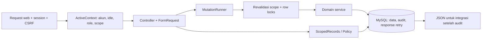

# Arsitektur aplikasi MVC

Laravel 13 / PHP 8.3+ / MySQL 8.4, satu aplikasi pada root project. Blade, Tailwind, JavaScript native dan Vite menyediakan frontend pada origin/session yang sama. GET browser pada halaman aplikasi dirender oleh FrontendController melalui RenderFrontend setelah pemeriksaan role/scope. Fetch dengan `Accept: application/json` meneruskan request ke controller JSON yang sudah ada. Unduhan TSV dan endpoint data tidak diintersep sebagai halaman.



| Lapisan | Implementasi |
|---|---|
| Controller | Auth/AuthenticatedSessionController, AssessmentController, ReportingController, FrontendController, FrontendDataController, SuperHc/OrganizationController, KpiTemplateController, TemplateImportController, CycleController |
| Request | LoginRequest, OrganizationRequest, AssessmentRequest, KpiTemplateRequest, CycleRequest; skor memakai rule Score sebelum SQL coercion |
| Middleware | ActiveContext memuat ulang akun/assignment per request; RenderFrontend memilih HTML sesudah otorisasi, tanpa mengubah kontrak JSON |
| IdentityAccess | ScopeResolver, AccessContext, MutationRunner; eligibility tidak sama dengan scope nyata |
| Model/Policy | Eloquent models dengan fillable/casts, AssessmentPolicy, guard Eloquent untuk Final/published/audit |
| Query | ScopedRecords membatasi lookup, daftar, agregat, timeline dan laporan sebelum hasil dibentuk |
| Service | AssessmentService, OrganizationService, KpiMasterService, AuditWriter |
| View | layouts/base dan app, auth/login, pages bersama dengan konfigurasi role, components dan errors; state JavaScript native di resources/js, token/aturan responsif di resources/css/app.css |

## Alur keputusan

```text
Anggota: draft/returned -> submitted -> final (ACC Kepala Divisi)
                                |-> returned (alasan KD)
                   submitted -> draft (tarik kembali KU)
Kepala Unit: draft -> final (nilai ditetapkan Kepala Divisi)
```

Super HC tidak memiliki endpoint keputusan nilai. `approved` tersisa sebagai nilai kompatibilitas schema lama, tidak dihasilkan workflow aktif. Nilai anggota tidak dapat diedit KD; penilaian Kepala Unit dibuat sebagai `unit_head` dan diikat pada assignment kepala yang dinilai.

## Transaksi dan integritas

MutationRunner mengunci akun aktor, memuat ulang konteks serta otorisasi record, lalu memeriksa UUID/hash replay. Service mengunci assessment/master/placement yang relevan, mengecek lock_version dan status, mengubah data, menulis audit, serta menyimpan response retry dalam transaksi yang sama. Retry deadlock dibatasi tiga upaya. Bulk ACC mengurutkan ID dan seluruh batch rollback jika satu item gagal.

Snapshot item dibuat dari template published tunggal saat assessment dimulai. MySQL menghitung weighted_result_raw sebagai generated column; total memakai SUM DECIMAL dan bcmath, bukan nilai dari browser. Final menyimpan kategori, total, waktu dan aktor KD sekaligus. Trigger MySQL menolak update/delete Final dan insert/update/delete item ke Final, termasuk akses query builder langsung.

Organisasi tidak mempunyai endpoint hard delete. Transfer menutup placement lama dan membuat yang baru; unit berhistori tidak dapat direparent. Satu kepala aktif per area dijaga UNIQUE generated. Assignment kepala diganti atomik, dengan eligibility dan keterkaitan employee untuk KU. O-6 memblokir dampak assessment non-Final, O-7 membatasi histori kepala secara konservatif.

## Keamanan dan operasional

Login email/NIP memakai hash, rate limit, session regeneration dan idle 30 menit. CSRF tetap aktif pada seluruh mutasi, termasuk login/logout. Tidak ada publik registrasi, API token, mass assignment status/bobot/total, atau pemilih role dari browser. Password tidak masuk audit atau response.

File session/cache dan queue sync digunakan tanpa tabel framework tambahan. Koneksi/timestamp UTC; input jadwal wajib offset, frontend menampilkan WIB. Deployment harus menggunakan public sebagai document root, HTTPS, APP_DEBUG=false dan user DB runtime terbatas. Hak SQL root lokal bukan profil produksi.

## Frontend dan read model

FrontendPages menentukan navigasi dari konteks server. Tidak ada role/scope pilihan client. FrontendController memeriksa detail assessment lewat ScopedRecords sebelum merender HTML. FrontendDataController memberikan lookup sesuai role, tren/matriks Final, KPI published dan pembanding bulan sebelumnya. Pembanding harus jenis dan template yang sama; salin mengubah draft lokal lalu melalui validasi PATCH biasa.

Frontend aktif memakai Blade dan Tailwind dengan modul JavaScript native. Desain ABprove diterapkan langsung di resources/views, resources/css dan resources/js. Pada tahap audit, AbproveDesign memuat fixture presentasi dan state bisnis disimpan lokal di browser. Login/logout tetap memakai session dan CSRF nyata. Modul desain tidak memanggil endpoint mutasi bisnis. Kontrak JSON, UUID retry, lock_version dan respons 401/419/409/422 tetap tersedia pada backend untuk integrasi berikutnya setelah persetujuan pengguna. Dialog native, toast, konfirmasi Final dan peringatan perubahan belum disimpan berbagi shell.

TemplateImport membaca CSV/XLSX sebagai data teks melalui ZipArchive/DOM, menolak formula/DOCTYPE serta membatasi file/ekstraksi/jumlah baris. Preview tidak menulis database; simpan draft dan publish tetap operasi master KPI yang berbeda. Semua nilai rekap/analitik memakai hasil server; total editor lokal hanya preview.

Kebijakan belum disahkan dan fitur berikutnya dijelaskan di [DECISIONS](../backend/DECISIONS.md). Kontrak implementasi: [panduan](../backend/README.md), [routes](ROUTES.md), [schema](../database/SCHEMA.md), [pengujian](../backend/test-result.json). Dokumen fondasi sebelum runtime disimpan di `archive/foundation`.
