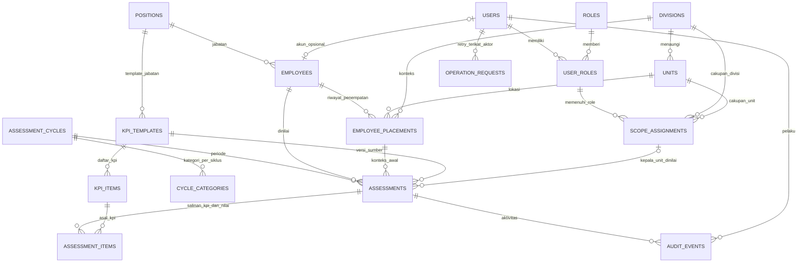

# ERD

FK komposit fisik menjaga konteks placement dan template. assessment_kind member/unit_head dan head_assignment_id membedakan objek penilaian; satu employee+cycle tetap satu lembar. operation_requests menyimpan hasil retry atomik. Diagram konseptual tidak menampilkan seluruh key. Sumber aktif: [SCHEMA.md](SCHEMA.md) dan [migrations](../../database/migrations/README.md).
