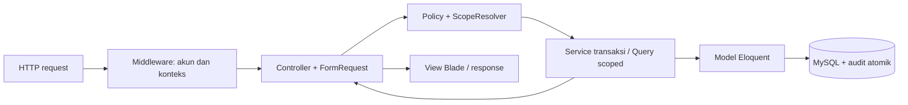

# Arsitektur backend - MVC standar

Status: struktur dan schema saja. Stack rancangan dari sumber: Laravel 13 / PHP >=8.3 / MySQL 8.4 LTS. Belum ada runtime Laravel, endpoint bisnis, implementasi frontend, atau deployment. Root repositori adalah folder KPI-Kinerja-UIUX ini, tidak ada backend/frontend project bersarang.

## 1. Pembagian MVC



| Lapisan | Lokasi | Tanggung jawab saat diimplementasikan |
|---|---|---|
| Model | app/Models | Relasi, cast, persistence; metadata mengikuti SCHEMA dan DDL |
| Controller | app/Http/Controllers | Input tervalidasi, otorisasi, panggil service/query, pilih view/response |
| View | resources/views | Tampilan auth, kepala-unit, kepala-divisi, super-hc; belum dibuat |
| FormRequest | app/Http/Requests | Shape input, integer 10-100, required reason, allowlist field; bukan otorisasi query |
| Middleware | app/Http/Middleware | Akun aktif, sesi, role/konteks yang sah pada setiap request |
| Policy | app/Policies | Izin per aksi/per record; bukan hanya menyembunyikan tombol |
| Service | app/Services/<domain> | Aturan bisnis dan transaksi lintas model, termasuk audit dalam transaksi sama |
| Query | app/Queries | Daftar, cari, agregat, detail, timeline dan rekap sudah scoped sebelum dihitung/paginasi |

Ini satu aplikasi Laravel dengan pembagian domain sebagai helper MVC. Tidak memakai app/Modules, microservices, repository generik, atau komponen Livewire sebagai pengganti controller utama. Usulan Livewire/Alpine/Tailwind/Vite pada sumber ditunda ke tahap frontend; bukan dependency wajib fase ini.

## 2. Rencana controller dan layanan

| Controller / area | Service / query yang akan dibutuhkan |
|---|---|
| Auth/AuthenticatedSessionController | Identitas email/NIP, akun aktif, regenerasi sesi, rate limit, logout |
| KepalaUnit/DashboardController | Progres unit dan tenggat dalam cakupan |
| KepalaUnit/AssessmentController | StartAssessment, SaveDraft, SubmitAssessment, WithdrawAssessment |
| KepalaUnit/MemberController; SubmissionController | Daftar anggota, pengajuan, detail terbatas unit |
| KepalaDivisi/ApprovalController | ApproveAssessment, ReturnAssessment; angka hanya baca |
| KepalaDivisi/TeamController | Unit dan anggota dalam divisi sah |
| SuperHc/OrganizationController; UnitController | CreateDivision, CreateUnit, AssignHead; preview dampak |
| SuperHc/EmployeeController; UserController | PlaceEmployee, TransferEmployee, pengaturan akun/cakupan |
| SuperHc/KpiTemplateController | ResolveTemplate, validasi bobot, versi baru dan publish |
| SuperHc/CycleController | Jadwal dan kategori dengan validasi cross-row |
| SuperHc/FinalizationController | FinalizeAssessment, BulkFinalize, return dan rekap |
| Reporting controllers (P1) | Analitik/riwayat berbasis Final dan perbandingan sebanding |
| Audit service | AppendAuditEvent dengan before/after allowlist, actor, role dan scope |

Nama di atas kontrak tanggung jawab, bukan file implementasi yang sudah ada. Tidak dibuat controller kosong bernama fitur yang memberi kesan endpoint siap dipakai.

## 3. Identitas dan scope

`user_roles` = kelayakan role; `scope_assignments` yang aktif = cakupan nyata. Resolver memeriksa akun aktif dan role/assignment setiap request. Kepala Unit mendapat unit yang ditugaskan; Kepala Divisi mendapat divisi yang ditugaskan dan unit turunannya. Super HC global hanya dengan assignment super_hc aktif.

Query harus memasukkan scope sebelum lookup record, COUNT, pagination, saran pencarian atau salin rekap. Field division_id/unit_id kiriman klien hanya filter dalam himpunan yang diizinkan, tidak memberi akses. Policy memeriksa lagi aksi serta status record. Pengubahan raw ID tidak boleh membocorkan nama/metadata di luar cakupan.

Histori memakai konteks organisasi pada assessment. Kebijakan histori pasca perpindahan tetap O-7; jangan otomatis memberi akses seluruh histori karena orang sekarang berada pada unit baru. UX multi-role/multi-area/delegasi O-5 belum ditetapkan; konteks ambigu ditolak sampai ada alur yang disahkan, bukan role-switch demo.

## 4. Transaksi dan state

Belum diisi adalah virtual (belum ada assessment). Transisi DB:

```text
draft/returned --KU submit lengkap--> submitted
submitted --KU withdraw--> draft
submitted --KD return + reason--> returned
submitted --KD approve--> approved
approved --HC return--> returned
approved --HC finalize--> final
```

Untuk mutasi: resolve scope dan query terotorisasi; BEGIN; lock record stabil (assessment, employee/unit sesuai operasi); periksa ulang izin dan expected lock_version; validasi transisi dan siklus; simpan item/header; tambahkan audit; COMMIT. Stale version menjadi konflik 409. Operasi gagal tidak menghasilkan status sukses atau perubahan parsial.

Urutan lock harus konsisten; bulk mengurutkan ID dan memakai batas batch. All-or-nothing per batch adalah usulan yang harus tampak pada UI. Retry deadlock terbatas tidak menggantikan idempotency.

Finalisasi memakai SUM weighted_result_raw generated database, validasi bobot tepat 100%, semua skor lengkap, dan resolve kategori. Update total raw, snapshot kategori, waktu/pelaku keputusan serta status dilakukan bersama audit. CHECK metadata tidak mencegah semua edit Final; policy/service dan privilege runtime harus mengunci header/item. Unlock tidak memiliki route sebelum O-8 disahkan.

## 5. Organisasi dan pemindahan

AssignHead mengunci area, memeriksa akun/role aktif, mencabut assignment sebelumnya dan membuat yang baru beserta audit dalam satu transaksi. Generated UNIQUE menjaga satu kepala aktif per area (usulan sumber), bukan membatasi organisasi hanya punya satu kepala global.

TransferEmployee memuat asal/tujuan, penanggung jawab dan penilaian aktif dari server; membutuhkan alasan dan konfirmasi. Lock employee dan placement; periksa ulang tujuan aktif serta konflik; tutup placement lama; buat baru; audit; commit. Selama O-6 belum diputuskan, blokir mutasi yang mempunyai dampak penilaian aktif. Bukan menebak status/penilai baru. Histori Final tidak dipindahkan. Jangan mengubah units.division_id sembarang untuk unit yang punya histori.

Setelah commit, semua daftar, count, scope dan tampilan role harus konsisten (ORG-12); contoh prototype berupa snapshot tidak menjadi cara implementasi persistence.

## 6. Kontrak penyimpanan dan keamanan

- UTC pada koneksi/kejadian, tampil WIB; assessment_month adalah hari pertama bulan dinilai, bukan bulan pemrosesan.
- DECIMAL persen 4 digit dan hasil 6 digit adalah usulan presisi; tanpa float otoritatif. Hasil item generated tidak di-mass-assign. Preview browser tetap opsional/tidak dipercaya.
- Template published tidak diedit in-place; buat versi baru. Snapshot Final tidak berubah akibat master/penempatan.
- Audit before/after disanitasi; jangan simpan password, hash, token atau isi sesi. Audit append-only melalui service dan izin DB runtime terpisah dari migrator.
- request_key UUID mengidentifikasi retry operasi kritis. Otorisasi dilakukan sebelum mengembalikan hasil retry; lookup tidak boleh menjadi bypass scope. UUID audit saja belum menyimpan response retry lengkap; protokol replay adalah tugas implementasi.
- Final, publish bobot 100%, kategori tidak overlap, template efektif tunggal dan transisi adalah aturan server lintas baris yang tidak seluruhnya dijamin DDL.
- Login aman: hash password, CSRF, session regeneration, cookie aman sesuai deployment, timeout 30 menit idle; tanpa registrasi publik. SSO O-4 belum aktif.
- Jangan hapus fisik users/user_roles yang direferensi histori. Cabut akses lewat assignment atau status akun; foreign key melindungi referensi lama.

## 7. Fase struktur sekarang

DDL domain berisi 16 tabel, seed tiga role dan tanpa akun default. Folder model/controller/view disiapkan, business services dan policies masih rencana. `routes/web.php` serta `console.php` hanya kerangka komentar, bukan endpoint. Tidak ada artisan, vendor, composer.lock, package frontend atau migrasi PHP executable.

Pada inisialisasi Laravel nanti, gunakan versi yang disepakati, gabungkan skeleton secara terkontrol (jangan menimpa docs/design/schema), lalu ubah DDL menjadi migrations ekuivalen. Initial import SQL dan migrations tidak boleh membuat tabel sama dua kali. Hapus asumsi migrasi users default starter kit yang bertentangan dengan schema khusus ini. Tambahkan tabel reset password/session/cache/queue hanya bersama fitur dan konfigurasi drivernya.

`.env.example` sekarang file session/cache dan sync queue; tidak menunjuk database driver tanpa tabel. Database session/cache/queue dari sumber adalah pilihan deployment mendatang, bukan kebutuhan schema domain tahap ini. DB dan APP key tetap kosong; tidak ada kredensial aplikasi produksi.

## 8. Pemeriksaan implementasi mendatang

Uji isolasi dua divisi, role/user nonaktif dan revocation; Draft/Submit/Approve/Return/Final; input pecahan dan manipulasi status; lock_version/idempotency; transaksi penempatan/kepala; bobot/template dan kategori cross-row; Final immutability; audit privilege; backup restore dan performa 500 karyawan. Fixture SQL bukan pengujian HTTP atau autentikasi Laravel.

Target MySQL 8.4 harus diuji sendiri sebelum migrations diterima. Hasil engine lokal ada di [VALIDATION](../database/VALIDATION.md). Butir O-1 sampai O-12 PRD tetap berlaku; blocker multi-role, histori, perubahan penilaian aktif, deadline dan unlock tidak diselesaikan secara diam-diam.

## 9. Referensi

- [Konvensi direktori Laravel 13](https://laravel.com/docs/13.x/structure)
- [Laravel 13 requirements](https://laravel.com/docs/13.x/deployment)
- [MySQL 8.4 foreign keys](https://dev.mysql.com/doc/refman/8.4/en/create-table-foreign-keys.html)
- [MySQL 8.4 generated columns](https://dev.mysql.com/doc/refman/8.4/en/create-table-generated-columns.html)
- [MySQL 8.4 CHECK](https://dev.mysql.com/doc/refman/8.4/en/create-table-check-constraints.html)
- [Schema](../database/SCHEMA.md), [DDL](../../database/schema/schema.mysql.sql), [PRD](../requirements/PRD-KPI-Kinerja-Revisi-v1.1.md).

Sumber awal yang tidak diubah tersedia di [archive/source](../../archive/source/). Dokumen ini mengganti struktur Livewire/Actions sebagai pusat aplikasi pada sumber menjadi MVC sesuai instruksi terbaru; helper transaksi tetap diperlukan agar controller tipis.
