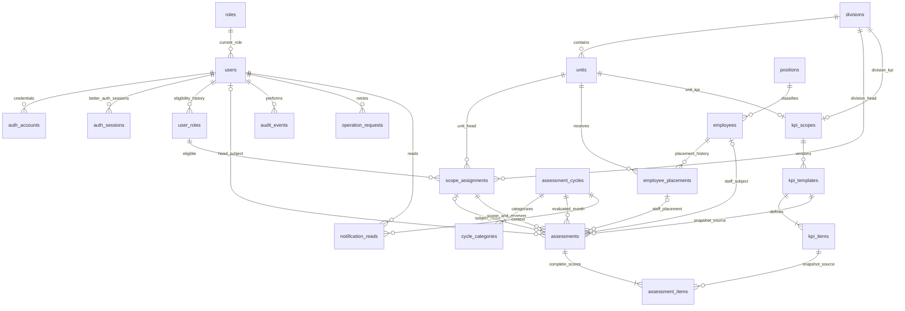

# ERD schema v3.0

Lihat [kamus dan aturan](SCHEMA.md). Unit bersifat turunan divisi; penanggung jawab dipisahkan sebagai riwayat assignment.

staff_subject dan head_subject adalah XOR. Seorang Kepala Unit merupakan users + scope_assignments, tidak menjadi staf berakun. audit_events.assessment_id sengaja bukan FK yang menghalangi penghapusan kiriman non-Final; ID peristiwa historis tetap tercatat setelah pembatalan.

auth_verifications menyimpan identifier dan nilai verifikasi Better Auth tanpa FK user. users tidak mempunyai password; auth_accounts adalah sumber hash. auth_sessions menyimpan context_key dan waktu aktivitas server untuk batas tidak aktif 30 menit. Pengiriman email belum diaktifkan.
