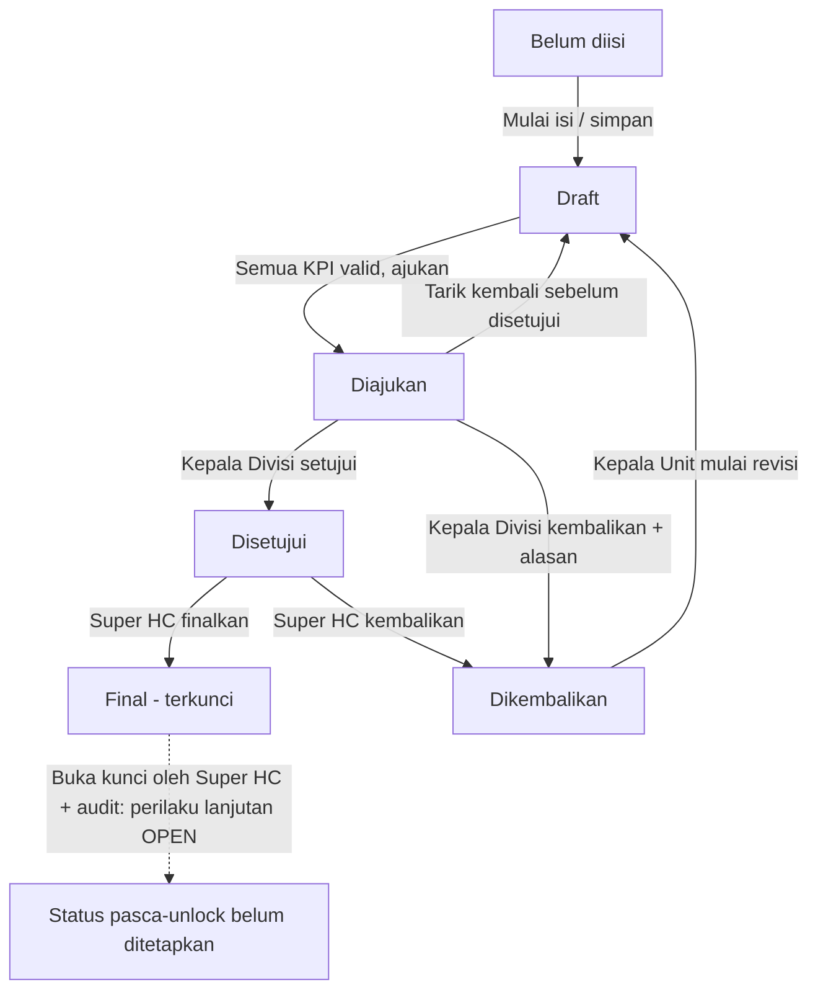

# UI/UX Blueprint — KPI Kinerja Awal Bros

> **Versi:** Draft v1.0 • 7 November 2026  
> **Rujukan:** PRD KPI Kinerja — Sistem Penilaian Kinerja Bulanan, halaman 1–10  
> **Sasaran:** Spesifikasi layar, navigasi, user flow, wireframe, microcopy, dan pengujian untuk handoff ke desain UI/frontend.  
> **Keterangan:** `[PRD]` berarti eksplisit pada PRD; `[USULAN]` berarti keputusan UI/UX; `[OPEN]` perlu persetujuan.

## 1. Information architecture

**Global:** Login → peran aktif → periode aktif → halaman sesuai peran. Burger kiri atas membuka menu pop-up; header selalu menampilkan konteks bulan. Peran aktif dapat diganti melalui profil jika pengguna memiliki lebih dari satu peran.

```text
Login [U-1]
  └── App Shell [U-2, U-3]
      ├── Kepala Unit
      │   ├── Beranda [KU-1, P0]
      │   ├── Isi Nilai [KU-2, KU-3, KU-4, KU-5, P0]
      │   ├── Pengajuan [KU-7, P0]
      │   ├── Riwayat [KU-8, P1]
      │   └── KPI Unit [KU-9, P1]
      ├── Kepala Divisi
      │   ├── Beranda [KD-1, P0]
      │   ├── Persetujuan [KD-2, KD-3, KD-4, P0]
      │   └── Dashboard Divisi [KD-6, P1]
      └── Super HC
          ├── Beranda [SDM-1, P0]
          ├── Rekap & Finalisasi [SDM-2, SDM-3, P0]
          ├── Master KPI [SDM-5, P0]
          ├── Pengaturan Siklus & Kategori [SDM-7, P0]
          ├── Pengguna & Struktur [SDM-8, P0]
          └── Dashboard Analitik [SDM-4, P1]
```

**P1 tambahan lintas peran:** panel notifikasi [U-4], bantuan pengisian [U-5], animasi/perpindahan tanpa reload [U-6]. Impor Excel [SDM-6] P1, setujui massal oleh Kepala Divisi [KD-5] P1, salin nilai bulan lalu [KU-6] P1. Pengingat otomatis [SDM-9] P2.

---

## 2. User flow utama dan otorisasi

### 2.1 Alur penilaian



**Catatan:** Status sistem mengikuti enam status PRD. Node `Status pasca-unlock` **bukan status ketujuh** — hanya penanda bahwa transisi setelah unlock belum didefinisikan PRD.

### 2.2 Siapa bisa melakukan apa

| Aksi | Kepala Unit | Kepala Divisi | Super HC |
|---|---|---|---|
| Lihat karyawan sesuai cakupan | Unit sendiri | Divisi sendiri | Seluruh RS |
| Isi/edit nilai di Draft/Dikembalikan | Ya | Tidak | Tidak |
| Simpan draft / ajukan / tarik pengajuan sebelum disetujui | Ya | Tidak | Tidak |
| Setujui atau kembalikan dari Diajukan | Tidak | Ya | Tidak |
| Setujui sekaligus dari Diajukan | Tidak | P1 | Tidak |
| Finalkan dari Disetujui | Tidak | Tidak | Ya |
| Finalkan sekaligus dari Disetujui | Tidak | Tidak | Ya (P0) |
| Kembalikan dari Disetujui | Tidak | Tidak | Ya |
| Ubah template KPI & bobot | Tidak | Tidak | Ya |
| Jadwal siklus/kategori | Tidak | Tidak | Ya |
| Kelola pengguna & struktur | Tidak | Tidak | Ya |
| Unlock Final + audit | Tidak | Tidak | Ya; alur lanjutan OPEN |

**Server sebagai sumber kebenaran:** semua aksi dievaluasi berdasarkan role aktif, unit/divisi, status, siklus, dan kepemilikan, bukan sekadar state tombol di browser.

### 2.3 Jalur singkat tiga peran

**Kepala Unit**: Beranda → pilih karyawan `Perlu diisi` → isi nilai → lihat hasil langsung → (opsional) isi temuan → Simpan draft / Ajukan → beralih otomatis ke karyawan berikutnya.

**Kepala Divisi**: Beranda → buka antrean `Menunggu` → pilih lembar nilai → periksa nilai + selisih bulan lalu + riwayat → Setujui / Kembalikan dengan catatan → lanjut ke antrean berikutnya.

**Super HC**: Beranda → lihat progres unit dan divisi → `Rekap & Finalisasi` → filter `Disetujui` → pilih satu/beberapa → konfirmasi finalisasi → status `Final` terkunci → salin rekap Excel.

---

## 3. Standar layout global

### Global header (`P0`)

```text
┌─────────────────────────────────────────────────────────────────────────┐
│ ☰   KPI Kinerja       [ Penilaian Oktober 2026  ▾ ]     [Profil / Peran ▾] │
├─────────────────────────────────────────────────────────────────────────┤
│ BERANDA  /  KEPALA UNIT                                                  │
│ Penilaian Oktober 2026                     Pengisian hingga 5 Nov 2026    │
└─────────────────────────────────────────────────────────────────────────┘
```

[USULAN] Ikon notifikasi pada shell diperkenalkan saat P1. [PRD U-2] Tugas tertunda tetap tampil di menu burger pada P0. Contoh tanggal di wireframe hanya ilustrasi: SDM harus dapat mengubah tanggal siklus.

### Menu burger (`P0`)

```text
┌──────────────────────────────────┐
│ KPI Kinerja                      │
│ Peran: Kepala Unit          [⇄]  │
│                                  │
│ Beranda                          │
│ Isi Nilai                    3   │
│ Pengajuan                     2  │
│ ───────────────────────────────  │
│ Profil                           │
│ Ganti peran (jika ada)           │
│ Keluar                           │
└──────────────────────────────────┘
```

- Popover ber-overlay pada desktop; full-height drawer pada ponsel.
- Ganti peran membersihkan state/form yang bukan milik role baru; konfirmasi dahulu bila perubahan belum tersimpan.
- Beri label dan hint tugas tertunda yang terhitung, misalnya "3 perlu diisi", bukan angka tanpa konteks.

---

## 4. Kepala Unit: spesifikasi layar

### KU-S01 — Beranda (`KU-1`, P0)

**Tujuan:** pengguna langsung tahu total pekerjaan, tenggat, dan kasus revisi.

**Hierarki konten:**

1. Greeting ringkas, periode aktif dan status siklus.
2. Ringkasan: `N karyawan`, `N diajukan`, `N dikembalikan`, `N belum diajukan`.
3. Progres: `2 dari 5 diajukan` dan progress bar.
4. Alert tenggat: tanggal absolut + WIB.
5. **Prioritas tinggi:** daftar penilaian Dikembalikan beserta komentar pengembalian dan aksi `Perbaiki`.
6. CTA primer `Lanjutkan penilaian`.

```text
Penilaian Oktober 2026                                  Batas: 5 November
Selesaikan nilai karyawan unit sebelum batas pengisian.
┌────────────────┐ ┌────────────────┐ ┌────────────────┐
│ Total karyawan │ │ Sudah diajukan │ │ Dikembalikan  │
│       5        │ │       2        │ │        1       │
└────────────────┘ └────────────────┘ └────────────────┘
Progres pengajuan        [████████░░░░░░░░░░░░]  2 dari 5

Perlu diperbaiki
┌────────────────────────────────────────────────────────┐
│ Nama karyawan  • Dikembalikan                          │
│ Catatan: Target KPI pelatihan perlu diperiksa ulang.    │
│                                           [Perbaiki]   │
└────────────────────────────────────────────────────────┘
                                              [Lanjutkan nilai]
```

**Empty state:** `Semua penilaian unit sudah diajukan. Pantau statusnya di Pengajuan.`

### KU-S02 — Isi Nilai (`KU-2` s.d. `KU-5`, P0)

**Tujuan:** input cepat, tanpa pindah halaman saat berganti karyawan.

**Layout desktop:** daftar karyawan di kiri, lembar nilai di kanan, total dan CTA terlihat.

```text
┌────────────────────────┬─────────────────────────────────────────────────┐
│ KARYAWAN UNIT          │ LEMBAR NILAI • Oktober 2026                     │
│ [Cari nama / NIP…]     │ NAMA KARYAWAN                     [Draft]        │
│ [Semua ▾] [Perlu diisi]│ Jabatan: Dokter Umum • Template: Pelayanan...  │
│                        │                                                 │
│ • Karyawan A [Draft]   │ Pilar | KPI      | Target | Bobot | Nilai | Hasil │
│ • Karyawan B [Kembali] │ ..... | KPI 1    | 95%    | 15%   | [90]  | 13,50 │
│ • Karyawan C [Diajukan]│ ..... | KPI 2    | 100%   | 10%   | [80]  |  8,00 │
│ • Karyawan D [Belum]   │ ..... | KPI 3    | -      | 10%   | [100] | 10,00 │
│                        │                                                 │
│                        │ Temuan positif (opsional)                        │
│                        │ [............................................] │
│                        │ Temuan negatif (opsional)                        │
│                        │ [............................................] │
│                        │                                                 │
│                        │ Total: 82,75 • Baik                             │
│                        │ [Simpan draft]        [Ajukan ke Kepala Divisi] │
└────────────────────────┴─────────────────────────────────────────────────┘
```

**Interaksi:**

- Pemilihan karyawan menyimpan state pilihan dan scroll; jika form masih berubah, konfirmasi `Simpan draft` / `Buang perubahan` / `Batal` sebelum berpindah.
- Nilai hanya bilangan bulat 10–100. `Enter` ke KPI berikut. Kolom hasil tidak dapat diedit.
- Tabel memuat kolom **Pilar, KPI, Target, Bobot, Nilai, Hasil** sesuai PRD; numerator/denominator/formula dapat ditampilkan sebagai informasi detail/tooltip bila diperlukan.
- Total dan kategori **live**; belum lengkap → `Total sementara` dan belum boleh diajukan.
- Draft bisa disimpan parsial. Ajukan hanya saat seluruh KPI bernilai, template valid, siklus mengizinkan, dan izin server benar.
- Setelah sukses Ajukan, otomatis pindah ke karyawan berikutnya yang belum selesai; jika tidak ada, tampilkan ringkasan selesai.
- Returned menampilkan banner catatan paling baru di atas tabel.
- `Salin nilai bulan lalu` hanya P1.

**Kasus batas:** template hilang/total bobot ≠100%; penilaian menjadi Final saat sedang dibuka; koneksi gagal saat menyimpan; status baru dari pengguna lain; periode sebelumnya read-only.

### KU-S03 — Pengajuan (`KU-7`, P0)

- **Tab:** `Dikembalikan`, `Menunggu`, `Disetujui`, `Final`, `Belum diajukan`.
- **Kolom:** karyawan, jabatan, total, kategori, status, berada di tahap siapa, terakhir diperbarui, aksi.
- `Tarik kembali` hanya terlihat/diizinkan bila status Diajukan dan belum disetujui.
- Pada setiap baris buka detail alur penilaian + riwayat read-only.
- Penilaian Final tidak menampilkan kontrol edit.

### KU-S04 — Riwayat (`KU-8`, P1)

- Tren rata-rata unit 12 bulan, matriks `karyawan × bulan`, klik sel membuka lembar nilai historis.
- Header menjelaskan periode, sumber, unit, dan agregasi. Jika bulan tidak punya data, tampilkan `—`, bukan nol.
- Daftar temuan yang bisa difilter; histori tak dapat diubah.

### KU-S05 — KPI Unit (`KU-9`, P1)

- Template KPI per jabatan **read-only**; kolom lengkap: Pilar, KPI, Numerator, Denominator, Formula Pengukuran, Target, Bobot KPI.
- Jumlah bobot di footer; bila kurang/lebih 100%, tunjukkan peringatan dan hubungi Super HC (bukan izin edit Kepala Unit).

---

## 5. Kepala Divisi: spesifikasi layar

### KD-S01 — Beranda (`KD-1`, P0)

**KPI cards:** `Menunggu persetujuan`, `Disetujui`, `Dikembalikan`, `Unit telah selesai`.

**Tabel progres per unit:** nama unit, Kepala Unit, diajukan/total, progress, batas persetujuan, status, CTA. Aksi `Kirim pengingat` ada di PRD, tetapi **[OPEN]** media/cara pengirimannya belum ditetapkan; desain awal tidak mengklaim pengiriman otomatis (fitur otomatis tetap P2).

### KD-S02 — Persetujuan (`KD-2`, `KD-3`, `KD-4`, P0)

```text
Persetujuan • Oktober 2026
[Menunggu 12] [Dikembalikan 3] [Disetujui 20] [Semua]
[Filter unit ▾] [Cari nama…]
┌───────────────────────────────┬──────────────────────────────────────────┐
│ LIST PER UNIT                 │ PANEL TINJAU • READ-ONLY                │
│ Unit A                        │ Nama karyawan • Jabatan • Unit          │
│   Karyawan A      [Diajukan] │ Total 82,75 • Baik                       │
│   Karyawan B      [Diajukan] │ Perubahan dari bulan lalu: +2,50        │
│ Unit B                        │ KPI / Target / Bobot / Nilai / Hasil     │
│   Karyawan C      [Diajukan] │ [Data tabel read-only]                  │
│                               │ Temuan (+) / Temuan (-)                  │
│                               │ Alur: Draft → Diajukan → …             │
│                               │ Riwayat                                 │
│                               │ [Kembalikan]               [Setujui]    │
└───────────────────────────────┴──────────────────────────────────────────┘
```

**Interaksi:**

- Review **read-only**; Kepala Divisi **tidak** mengubah nilai KPI (aturan peran halaman 2 dan tabel halaman 6).
- Selisih KPI terhadap bulan lalu tampil jelas; jika belum ada data historis, `Belum ada pembanding`.
- Temuan positif/negatif ditandai agar bisa diperiksa.
- `Kembalikan` membuka dialog dengan alasan wajib sebelum mengirim balik ke Kepala Unit.
- `Setujui` hanya untuk status Diajukan; pindah ke karyawan berikutnya dalam antrean setelah sukses.
- `Pilih beberapa → Setujui sekaligus` dipasang pada P1, bukan P0.

**Microcopy dialog:**

```text
Kembalikan penilaian?
Penilaian Karyawan A akan dikirim kembali ke Kepala Unit.
Alasan pengembalian *
[Masukkan perbaikan yang perlu dilakukan…]
[Batal]                              [Kembalikan penilaian]
```

### KD-S03 — Dashboard Divisi (`KD-6`, P1)

- Analitik setara yang relevan dari SDM-4, **terbatas pada divisinya**.
- Filter unit, jabatan, kategori; rata-rata, tren, dan sebaran, termasuk alternatif tabel.

---

## 6. Super HC: spesifikasi layar

### SDM-S01 — Beranda (`SDM-1`, P0)

**Satu layar pemantauan siklus:**

```text
Rekap Siklus • Penilaian Oktober 2026               [Atur jadwal]
[Belum diajukan 38]   [Diajukan 70]   [Disetujui 42]   [Final 350]

Progres per divisi / unit
┌──────────────────────────────────────────────────────────────────────┐
│ Divisi                 Jumlah    Diajukan    Disetujui     Final      │
│ Pelayanan Medis          ...        ...         ...         ...       │
│ Keperawatan              ...        ...         ...         ...       │
└──────────────────────────────────────────────────────────────────────┘
Aktivitas terbaru                                 [Buka Rekap & Finalisasi]
• ... Kepala Divisi menyetujui penilaian karyawan …
```

**Catatan penting:** angka dalam wireframe hanya dummy untuk menunjukkan komposisi. Bila `Belum diajukan` mencakup Draft/Dikembalikan, label harus menjelaskan definisi dan mencegah perhitungan ganda. Gunakan definisi status yang konsisten dengan backend.

### SDM-S02 — Rekap & Finalisasi (`SDM-2`, `SDM-3`, P0)

- Tab per status (termasuk Disetujui yang siap Final), filter divisi/unit, periode, dan search.
- Kolom: checkbox, nama, jabatan, unit, divisi, total, kategori, status, tindakan.
- CTA `Finalkan` per baris + `Finalkan N penilaian` massal, hanya saat status **Disetujui**.
- Modal konfirmasi menyebut jumlah yang valid, yang tidak valid (bila ada), dan konsekuensi "Terkunci setelah Final".
- `Kembalikan ke Kepala Unit` untuk penilaian Disetujui; [USULAN] alasan wajib juga untuk Super HC agar rekam jejak bermakna, meski PRD tegas mewajibkan alasan hanya bagi Kepala Divisi.
- **Salin rekap Excel:** salin tabel tab-delimited/TSV dengan kolom persis: `Nama`, `Jabatan`, `Unit`, `Divisi`, `Bulan`, `Status`, `Total`, `Kategori`, `Temuan`. Paste ke Excel; jangan mengklaim sudah membuat file `.xlsx` kecuali fitur export benar-benar dibuat.
- Data yang masuk clipboard tetap dibatasi oleh role, filter dan periode; tampilkan konfirmasi `N baris berhasil disalin` setelah clipboard API sukses.

### SDM-S03 — Master KPI (`SDM-5`, P0; `SDM-6`, P1)

**List templates:** nama, jabatan, tahun, jumlah KPI, total bobot, status validitas, terakhir diubah.

**Editor template:**

```text
Template KPI — Pelayanan Medis - GP               Tahun: 2026
[Pilar] [Nama KPI] [Numerator] [Denominator] [Formula] [Target] [Bobot %]
[     ] [        ] [         ] [           ] [     ] [      ] [      ]
[+ Tambah KPI]

Total bobot: 95%  ⚠ Kurang 5% dari 100%
[Batal]                                      [Simpan template (nonaktif)]
```

- **Wajib 100%** tepat sebelum template disimpan, jumlah bobot dihitung live.
- Form menyimpan target sebagai **teks**, termasuk `<20%`.
- Pilihan pilar hanya: `Technical Care`, `Access`, `Coordination and Continuity`, `Interpersonal Care`, `Efficient`.
- [USULAN] Editor mengingatkan potensi dampak perubahan dan meminta catatan saat menyunting template aktif. Nilai historis Final tidak ikut berubah.
- Impor Excel dan validasi baris bermasalah di P1, bukan fitur pilot P0.

### SDM-S04 — Pengaturan (`SDM-7`, P0)

- Form siklus: bulan yang dinilai, tanggal buka, batas pengisian, batas persetujuan, tanggal penutupan.
- Urutan wajib logis: buka ≤ batas isi ≤ batas setuju ≤ tutup; jika batas tanggal melampaui batas lain, inline error.
- **Batas kategori** dapat diubah. Tampilkan preview rentang nonoverlap dari empat kategori.
- [USULAN] Perubahan pengaturan siklus setelah ada penilaian perlu konfirmasi dan riwayat untuk audit (detail otorisasi disepakati dengan tim IT).

### SDM-S05 — Pengguna & Struktur (`SDM-8`, P0)

- Kelola `Divisi → Unit → Jabatan`, pengguna, karyawan, dan pemetaan peran + cakupan.
- Peran jamak per pengguna didukung; menu role switch pada global shell.
- `Karyawan` dapat berbeda dari akun `Pengguna`, sesuai struktur data PRD.
- Aksi perubahan struktur perlu memperingatkan potensi penilaian aktif yang terkait; jangan memindahkan penilaian historis otomatis.

### SDM-S06 — Dashboard Analitik (`SDM-4`, P1)

**Filter global:** periode/tahun, divisi, unit, jabatan, kategori.

**Konten:** rata-rata total, distribusi 4 kategori, tren 12 bulan, rata-rata/unit, nilai per KPI × bulan, peringkat, dan temuan. Gunakan bar/line dengan label metrik, jumlah data, dan tabel alternatif. Hindari urutan peringkat individu tanpa interpretasi konteks jabatan/template.

---

## 7. State & permission matrix per status

| Status saat ini | Pemilik tindakan | Primary CTA pada detail | Read-only? | Keputusan berikut |
|---|---|---|---|---|
| Belum diisi | Kepala Unit | `Mulai isi nilai` | Belum ada data | Simpan Draft |
| Draft | Kepala Unit | `Simpan draft` / `Ajukan` | Tidak (KU yang berwenang) | Diajukan |
| Diajukan | Kepala Divisi | `Setujui` / `Kembalikan` | Ya untuk angka pada KD | Disetujui / Dikembalikan |
| Diajukan (KU) | Kepala Unit | `Tarik kembali` | Edit baru setelah ditarik | Draft |
| Disetujui | Super HC | `Finalkan` / `Kembalikan` | Ya kecuali aksi workflow | Final / Dikembalikan |
| Dikembalikan | Kepala Unit | `Perbaiki nilai` | Tidak untuk KU dalam cakupan | Draft lalu Diajukan |
| Final | Semua peran berizin | `Lihat detail` | **Ya, terkunci** | Super HC unlock [OPEN] |

Jika tidak ada izin atau deadline telah menutup kemampuan mutasi, UI menjelaskan kondisi. Aturan bisnis tepat setelah deadline masih [OPEN] dan tidak boleh ditebak.

---

## 8. Error / empty / loading / konflik

### Empty states penting

- Kepala Unit tanpa karyawan: `Belum ada karyawan yang terdaftar pada unit ini. Hubungi Super HC.`
- Semua nilai sudah selesai: `Semua penilaian sudah diajukan. Anda dapat memantau persetujuannya.`
- Tidak ada approval pending: `Tidak ada penilaian yang menunggu persetujuan untuk periode ini.`
- Tidak ada penilaian siap Final: `Belum ada penilaian yang disetujui dan siap difinalkan.`
- Filter kosong: `Tidak ada hasil sesuai filter. Ubah atau hapus filter.`
- Periode sudah Final: `Penilaian periode ini terkunci dan hanya dapat dilihat.`

### Kasus konflik

- Dua pengelola membuka objek sama; sistem mendeteksi perubahan versi dan menolak mutasi stale (`409`).
- Status berubah setelah tabel dibuka (seorang KD telah setuju, lalu Super HC finalkan). Refresh status saat action, tampilkan pesan spesifik.
- Session 30 menit idle berakhir; tidak mengklaim draft tersimpan bila simpan belum berhasil.
- Jika API simpan gagal, pertahankan input lokal sebisa mungkin sampai pengguna memilih retry/navigasi; jangan menyamarkan kegagalan.
- Jika hanya 5 dari 6 KPI valid, total diberi label "sementara"; tombol Ajukan tidak aktif.
- Jika template KPI tidak valid, blokir pengajuan dan arahkan Super HC memperbaiki Master KPI.

---

## 9. Skenario acceptance P0 yang dapat diuji

| ID | Given | When | Then |
|---|---|---|---|
| AC-01 | Kepala Unit login dan punya dua peran | Buka menu profil | Role aktif dapat dipilih dari role yang sah |
| AC-02 | KU unit A mengetahui URL karyawan unit B | Buka URL/API unit B | Server menolak akses tanpa data bocor |
| AC-03 | KU mengisi nilai `9`, `101`, `80,5` | Simpan/Ajukan | Validasi integer 10–100 gagal dengan pesan inline |
| AC-04 | Belum semua KPI terisi | Klik Ajukan | Ajukan terblokir; Simpan draft tetap dapat dipakai |
| AC-05 | Bobot 15%, nilai 90 | Isi nilai | Hasil langsung `13,50` |
| AC-06 | Total `82,75` & batas default | Lihat ringkasan | Kategori `Baik` |
| AC-07 | Draft lengkap dan valid | Ajukan | Status Diajukan; halaman pilih karyawan belum selesai berikutnya |
| AC-08 | Status Diajukan belum disetujui | KU tarik kembali | Status Draft; dapat diedit KU |
| AC-09 | KD memeriksa Diajukan | Buka detail | Nilai read-only; data selisih dan riwayat tersedia |
| AC-10 | KD mengembalikan | Kosongkan alasan lalu konfirmasi | Tidak bisa submit; alasan wajib |
| AC-11 | KD menyetujui | Konfirmasi sukses | Status Disetujui; lanjut antrean |
| AC-12 | Super HC memilih 3 penilaian Disetujui | Finalkan massal | Dialog menyebut 3; semua valid menjadi Final setelah server sukses |
| AC-13 | Penilaian berstatus Final | User manapun mencoba edit | Ditolak; detail read-only |
| AC-14 | Super HC membuka kunci Final | Lakukan aksi yang disetujui [OPEN] | Harus ada audit trail; transition ditetapkan dulu |
| AC-15 | Template KPI bobot total 95% | Simpan template | Diblokir dengan informasi `Kurang 5%` |
| AC-16 | Pengguna mengubah nilai/status/catatan | Buka riwayat | Tercatat pelaku, timestamp WIB, aksi dan catatan |
| AC-17 | Pengguna buka bulan Final | Pilih periode itu | Read-only dengan label Final |
| AC-18 | Pengguna menyalin rekap | Paste di Excel | Kolom sesuai PRD, angka dan kategori terbaca benar |
| AC-19 | Pengguna hanya punya akses divisi A | Buka filter unit/divisi | Tidak muncul data divisi lain |
| AC-20 | Pengguna navigasi keyboard | Enter pada input KPI | Fokus pindah input berikut; `Tab` dan `Shift+Tab` bekerja |

---

## 10. Urutan desain dan implementasi

### Fase 1 — Pilot satu divisi (semua P0)

1. Tentukan enam isu [OPEN] yang memblokir domain/perizinan (khususnya siapa menilai pimpinan, login, dan perubahan master).
2. Finalkan token visual + AppHeader + NavPopover + MonthPicker + RoleSwitcher.
3. Bangun `StatusBadge`, `DataTable`, `ScoreInput`, `KpiScoreTable`, `LiveScoreSummary`, `ApprovalTimeline`.
4. Bangun login, Beranda KU, Isi Nilai, Pengajuan.
5. Bangun Beranda KD, Persetujuan, ReviewDrawer, ReturnDialog.
6. Bangun Beranda Super HC, Rekap & Finalisasi, Master KPI, Pengaturan, Pengguna & Struktur.
7. Jalankan skenario acceptance P0 dan **bandingkan total nilai setiap karyawan pilot dengan file Excel**.

### Fase 2 — Seluruh rumah sakit

- Seluruh unit/divisi; impor Master KPI Excel (SDM-6), dashboard SDM (SDM-4), riwayat KU (KU-8), dashboard KD (KD-6), notifikasi/bantuan P1, salin nilai bulan lalu P1.
- Setelah dua siklus berturut-turut, target ≥95% diajukan sebelum batas pengisian.

### Fase 3 — Penyempurnaan

- Pengingat otomatis email/WhatsApp (P2), laporan tahunan, dan penyelesaian isu terbuka sesuai persetujuan SDM.

**Tidak termasuk pilot:** self-assessment, 360°, payroll/bonus, integrasi otomatis numerator/denominator dari SIMRS, dan OKR berjenjang.

---

## 11. Spesifikasi handoff desain → developer

Setiap layar di desain final sebaiknya memiliki:

- Nama layar, route (jika sudah disepakati), role dan scope, kode requirement, prioritas P0/P1/P2.
- Default view dan contoh data fiktif (jangan gunakan data pribadi asli pada mockup).
- Semua state: loading, empty, error, validasi, success, disabled, read-only, final.
- Responsive layout 1440px, 1024px, 768px, 390px (minimal) dan perilaku overflow.
- Keyboard/focus/tab order, konfirmasi modal, tooltip, dan feedback pasca aksi.
- Aturan permission dan transisi status yang didukung backend.
- Event audit yang perlu tercatat dan waktu tampilan `Asia/Jakarta`.

**Dependency penting:** Acuan prototype interaktif disebutkan dalam PRD, tetapi file/link prototype tersebut tidak disertakan pada lampiran ini. Blueprint ini **bukan** rekonstruksi persis prototype; jika prototype dibagikan, perlu ada *visual parity review* sebelum UI final.
