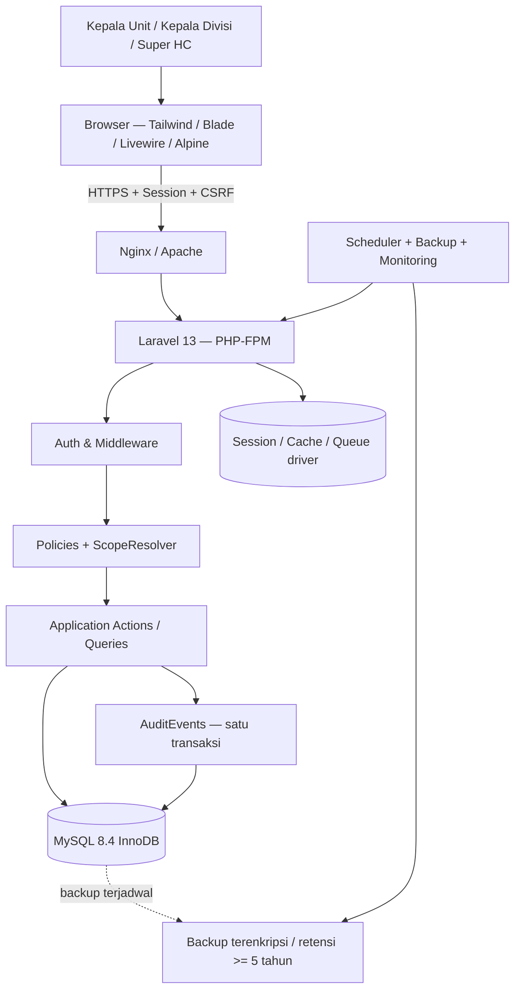
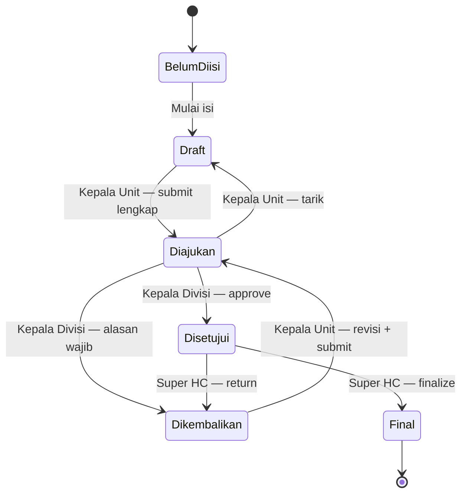
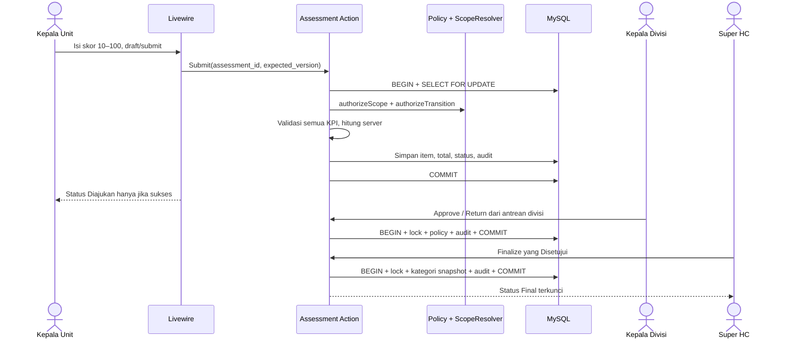
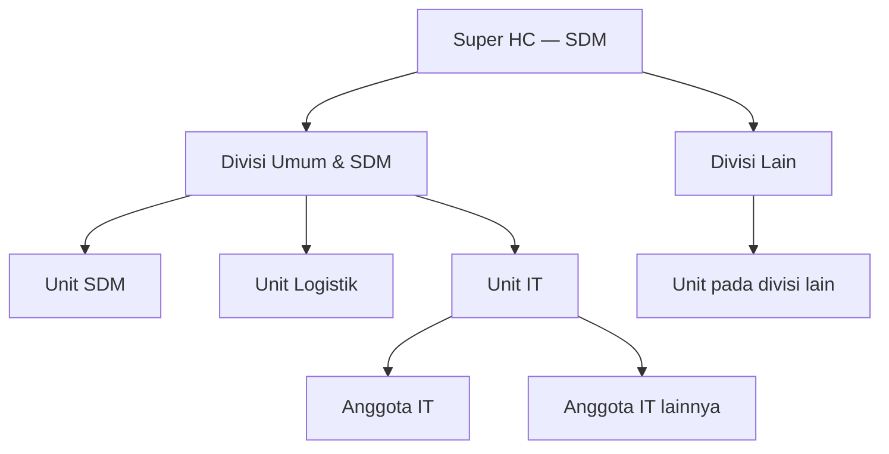
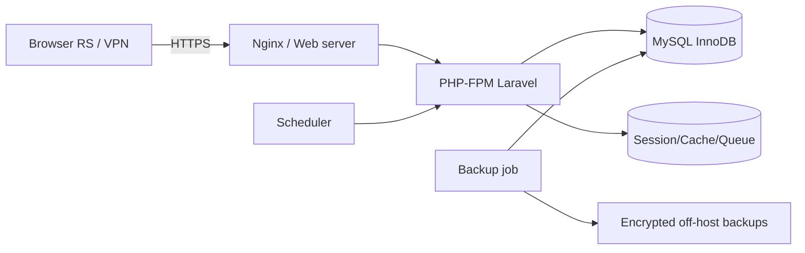

# ARCHITECTURE — KPI Kinerja Bulanan Awal Bros

**Sumber kebutuhan:** PRD Revisi v1.1, 8 November 2026.  
**Stack dipilih pengguna:** Laravel + MySQL + Tailwind CSS.  
**Rekomendasi implementasi:** **Laravel 13, PHP >= 8.3, MySQL 8.4 LTS, Blade + Livewire 4 + Alpine.js, Tailwind CSS 4, Vite**.  
**Status:** rancangan arsitektur; belum ada kode aplikasi produksi, keputusan OPEN tidak diisi otomatis.

## 1. Keputusan arsitektur

| Aspek | Pilihan | Alasan / batas |
|---|---|---|
| Pola aplikasi | **Modular Monolith** satu repositori Laravel | Satu domain internal RS, 3 role, relasi transaksional; microservices terlalu mahal untuk pilot |
| HTTP + rendering | Server-side Laravel + Blade + Livewire | UI dashboard interaktif, tanpa frontend SPA atau API terpisah |
| Interaksi kecil | Alpine.js | Dialog, filter, fokus, pratinjau total langsung di browser; hasil server tetap otoritatif |
| Gaya | Tailwind 4 dan Vite | Ikuti design system PRD; CSS tokens terpusat |
| Database | MySQL 8.4, InnoDB, utf8mb4 | Integritas FK, transaksi, `UNIQUE`, `CHECK`, generated column |
| ORM | Eloquent + query builder | Model/relasi dan query terkontrol; larang mass assignment kolom kewenangan |
| Auth | Session Laravel/Fortify via starter kit Livewire | Login email/NIP + password, registrasi publik dimatikan, opsi SSO O-4 |
| Otorisasi | Laravel Policies + query scopes + `ScopeResolver` | Periksa role **dan scope** pada setiap query/aksi, bukan hanya middleware menu |
| Mutasi | Action classes + `DB::transaction()` + locks | Multi-entitas atomik, pencegahan konflik dan duplikasi |
| Audit | `audit_events` append-only | Semua mutasi nilai/status/struktur disimpan dengan pelaku, konteks, alasan |
| Async | Queue database opsional; SMTP/WhatsApp belum P0 | P1/P2 notifikasi/impor; hindari dependensi Redis wajib untuk pilot |
| API publik | **Tidak diperlukan pada pilot** | Tambahkan versi `/api/v1` hanya jika integrasi kelak disetujui |

Dokumen ini tidak menganggap prototype FigCraft telah menjalankan auth, persistence, atau otorisasi. UI prototype hanya menjadi referensi visual dan interaksi.

### Diagram tingkat tinggi



Pada pilot, aplikasi dan database bisa ditempatkan dalam jaringan/infrastruktur yang disetujui IT RS. Backup **di luar** server utama, TLS, akses internal/VPN, pengelolaan rahasia, dan restore drill harus disiapkan sebelum data nyata masuk.

## 2. Bounded modules (dalam satu Laravel)

| Modul | Aggregate / data | Service / action utama | Halaman / kebutuhan |
|---|---|---|---|
| **IdentityAccess** | User, Role, UserRole, ScopeAssignment | `AssignRole`, `AssignHead`, `RevokeScope`, `ResolveScope` | Login, Pengguna, ORG-7/8 |
| **Organization** | Division, Unit, Position, Employee, Placement | `CreateDivision`, `CreateUnit`, `PlaceEmployee`, `TransferEmployee`, `DeactivateUnit` | Divisi & Tim, Tim Divisi, Anggota Unit, ORG-1..12 |
| **KpiMaster** | KpiTemplate, KpiItem | `CreateTemplateVersion`, `PublishTemplate`, `ResolveTemplate` | Master KPI, editor; impor Excel P1 |
| **AssessmentCycle** | AssessmentCycle, CycleCategory | `OpenCycle`, `UpdateDeadlines`, `ValidateCategories` | Pengaturan siklus & batas kategori |
| **Assessment** | Assessment, AssessmentItem | `StartAssessment`, `SaveDraft`, `SubmitAssessment`, `WithdrawAssessment` | Isi Nilai, Pengajuan |
| **Approval** | Assessment, AuditEvent | `ApproveAssessment`, `ReturnAssessment`, `FinalizeAssessment`, `BulkFinalize` | Persetujuan, Rekap & Finalisasi |
| **Reporting** | Read-only queries atas penilaian & organisasi | `UnitProgress`, `DivisionInbox`, `OrgSummary`, `CopyRecap` | Beranda per role, rekap P0, analitik P1 |
| **Audit** | AuditEvent | `AppendAuditEvent`, `GetAssessmentTimeline` | Timeline, tindakan organisasi, forensik |
| **Notifications** (P1/P2) | Notifikasi/queue | `CreateTaskNotification`, `SendReminder` | Panel notifikasi dan pengingat otomatis |

**Batas modul:** Controller/Livewire hanya menerima input, otorisasi dan menampilkan hasil. Mutasi bisnis dilakukan oleh `Actions`, query terotorisasi oleh `Queries`, aturan nilai oleh `Domain`/services. Jangan menaruh rumus KPI atau logic scope pada Blade maupun komponen Livewire.

## 3. Struktur folder Laravel yang disarankan

```text
kpi-kinerja/
├── app/
│   ├── Actions/
│   │   ├── IdentityAccess/       # AssignHead, RevokeScope
│   │   ├── Organization/         # PlaceEmployee, TransferEmployee
│   │   ├── KpiMaster/            # PublishTemplate, ResolveTemplate
│   │   ├── Cycle/                # OpenCycle, UpdateCycleSettings
│   │   └── Assessment/           # SaveDraft, Submit, Approve, Return, Finalize
│   ├── Domain/
│   │   ├── Assessment/
│   │   │   ├── AssessmentStatus.php
│   │   │   ├── AssessmentTransition.php
│   │   │   └── ScoreCalculator.php
│   │   └── Organization/
│   │       └── ScopeType.php
│   ├── Http/
│   │   ├── Controllers/          # Download/copy endpoint bila diperlukan
│   │   ├── Middleware/           # EnsureAccountActive, context-aware guard
│   │   └── Requests/             # FormRequest untuk setiap mutasi
│   ├── Livewire/
│   │   ├── Unit/                 # Dashboard, ScoreEntry, Submissions, Members
│   │   ├── Division/             # Dashboard, ApprovalInbox, Team
│   │   └── Hc/                   # Dashboard, Finalization, KpiMaster, Organization
│   ├── Models/                   # Eloquent (sesuai SCHEMA.md)
│   ├── Policies/                 # Assessment, Division, Unit, Employee, Template
│   ├── Queries/                  # Scoped query classes, agregat, rekap
│   ├── Services/
│   │   ├── ScopeResolver.php
│   │   ├── AssessmentCategoryResolver.php
│   │   └── AuditWriter.php
│   ├── Enums/                    # RoleKey, CategoryCode, KpiPillar
│   └── Exceptions/               # ScopeDenied, DomainConflict
├── database/
│   ├── migrations/               # P0 sesuai SCHEMA.md
│   ├── seeders/                  # 3 role & demo fixture fiktif
│   └── factories/
├── resources/
│   ├── css/app.css               # Tailwind 4 + design tokens
│   ├── js/app.js                 # Alpine sederhana; jangan simpan hak akses di JS
│   └── views/
│       ├── layouts/              # app shell 232px sidebar / 64px topbar
│       ├── components/           # kpi-table, status-badge, deadline, dialog
│       └── livewire/             # role-specific pages
├── routes/web.php                # auth/session/role-groups
├── tests/
│   ├── Feature/Auth/
│   ├── Feature/ScopeIsolation/
│   ├── Feature/Organization/
│   ├── Feature/Assessment/
│   ├── Feature/Finalization/
│   └── Unit/ScoreCalculatorTest.php
├── docs/PRD.md
├── docs/SCHEMA.md
└── docs/ARCHITECTURE.md
```

Jika proyek berkembang, folder `app/Actions`, `app/Queries`, dan `app/Domain` dapat dipindah ke `app/Modules/<Module>/...` tanpa mengubah pola satu aplikasi/deployment. Jangan membangun lapisan `Repository` generik untuk semua model jika hanya membungkus Eloquent tanpa aturan bisnis.

## 4. Autentikasi dan otorisasi

### Login

1. Login menggunakan **email atau NIP** dan password. NIP login di `users.login_nip` (bukan mengasumsikan seluruh `employees` punya akun).
2. Cek `users.is_active` sebelum menerbitkan sesi dan pada setiap request terproteksi.
3. Setelah login, role yang **layak** berasal dari `user_roles`, scope yang benar-benar **aktif** berasal dari `scope_assignments`.
4. Jika akun hanya mempunyai satu role/scope sah, masuk ke dashboard terkait. Jika lebih dari satu, **UI pemilihan konteks harus menunggu keputusan O-5**. Sistem boleh menolak alur ambigu sampai UX resmi disahkan; dilarang memilih konteks yang tidak dimiliki pengguna.
5. Gunakan session cookie `HttpOnly`, `Secure`, `SameSite`, regenerasi session ID saat login, logout invalidasi session; CSRF wajib untuk mutasi.
6. Timeout **30 menit idle**, rate limit login, tanpa registrasi publik. Opsi SSO O-4 bukan bagian default.

### Resolver scope

Contoh (pseudocode):

```php
$scope = $scopeResolver->forUser($request->user()); // DB: akun + role + scope aktif

// Query Kepala Unit tidak menerima unit_id bebas dari klien:
$query->whereIn('assessments.unit_id', $scope->authorizedUnitIds());

// Kepala Divisi hanya boleh scope divisi yang ditugaskan:
$query->whereIn('assessments.division_id', $scope->authorizedDivisionIds());

// Super HC bisa mengakses semua divisi hanya jika punya penugasan super_hc aktif.
```

**Aturan penting:** `authorizedUnitIds()` untuk Kepala Divisi dapat berasal dari unit di divisi penugasannya, **tetapi** akses histori harus tunduk pada O-7; jangan otomatis membuka assessment Final lama ketika anggota sekarang berpindah unit/divisi. Untuk menghindari pelebaran akses sampai kebijakan O-7 disahkan, query penilaian historis menggunakan **konteks `division_id` dan `unit_id` yang tertanam dalam record assessment** ditambah assignment saat request, bukan `employees.current_unit_id`.

### Matriks tindakan

| Aksi | Kepala Unit | Kepala Divisi | Super HC |
|---|---|---|---|
| Lihat dashboard/penilaian | Unit sah | Divisi sah | Seluruh organisasi |
| Isi angka dan temuan | Draft/Dikembalikan dalam unit sah | Ditolak | Ditolak |
| Tarik pengajuan | `submitted` dalam unit sah | Ditolak | Ditolak |
| Approve | Ditolak | `submitted` dalam divisi sah | Ditolak |
| Return | Ditolak | `submitted` + alasan wajib | `approved`; alasan wajib masih O-10 |
| Finalize | Ditolak | Ditolak | Hanya `approved` |
| Master KPI / siklus / organisasi | Hanya lihat sesuai fitur | Hanya lihat sesuai fitur | Kelola |
| Unlock Final | Ditolak | Ditolak | **Dinonaktifkan** sampai O-8 |

Gunakan `AssessmentPolicy`, `EmployeePolicy`, `DivisionPolicy`, `UnitPolicy` dan `KpiTemplatePolicy`. Policy memutuskan aksi per record; **query list dan statistik juga harus disaring sebelum dipaginasi/dihitung**. Jangan mengandalkan `@can`/menyembunyikan menu saja. Untuk ID di luar scope, respon 404 atau 403 tanpa memuat data atau metadata sensitif. Audit kejadian denial seperlunya tanpa mengekspos isi entitas.

## 5. Mesin status penilaian

`not_started` ditampilkan jika row assessment belum ada. Status DB memakai `draft`, `submitted`, `returned`, `approved`, `final`.



**Invariant:** Kepala Divisi tidak boleh mengubah angka, Super HC tidak boleh mengisi angka. Pengembalian dan penarikan harus meninggalkan audit. `final` immutable; **tidak ada endpoint unlock** sebelum O-8. Pemeriksaan tenggat dilakukan dalam service berdasarkan siklus; aturan yang belum ditetapkan di O-9 tidak boleh dibuat sebagai bypass tersembunyi.

### Sequence: isi → approve → finalisasi



### Contoh action mutasi — pseudocode Laravel

```php
public function submit(User $actor, int $id, int $expectedVersion): Assessment
{
    return DB::transaction(function () use ($actor, $id, $expectedVersion) {
        $assessment = Assessment::query()
            ->with('items')
            ->lockForUpdate()
            ->findOrFail($id);

        Gate::forUser($actor)->authorize('submit', $assessment);
        if ($assessment->lock_version !== $expectedVersion) {
            throw new DomainConflict('Data telah berubah; muat ulang.'); // HTTP 409
        }
        if (! in_array($assessment->status, ['draft', 'returned'], true)) {
            throw new DomainConflict('Status tidak mengizinkan pengajuan.');
        }

        $this->validateCycleAndCompleteness($assessment);
        $this->scoreCalculator->recalculateAndPersist($assessment); // integer + DECIMAL
        $assessment->forceFill([
            'status' => 'submitted',
            'submitted_at' => now(),
            'lock_version' => $assessment->lock_version + 1,
        ])->save();

        $this->auditWriter->appendAssessmentEvent($actor, $assessment, 'assessment.submitted');
        return $assessment->refresh();
    }, 3);
}
```

Ini **pseudocode arsitektur**, bukan file Laravel siap eksekusi: pemeriksaan idempotency, validasi input, penyaringan scope pada query awal, serta serialisasi respons perlu dilengkapi pada implementasi.

## 6. Organisasi, penempatan, dan hak akses lintas divisi

### Hierarki



**Pembagian kewenangan:** penanggung jawab Divisi Umum & SDM dapat review penilaian Unit SDM, Logistik dan IT; Kepala Unit IT hanya mengisi anggota IT; kepala divisi/unit lain tidak melihat data tersebut.

### Alur `TransferEmployee` (ORG-5/6/10/12)

1. **Preview** dari server: asal, tujuan, kepala tujuan, unit/divisi, role berdampak, penilaian `draft/submitted/returned/approved`, histori Final; input harus menyertakan alasan dan tujuan eksplisit.
2. **Guard**: user harus Super HC sah, employee aktif, tujuan aktif, tidak sama dengan asal; dan **tolak mutasi jika ada penilaian aktif yang belum ditentukan penanganannya** (O-6). Aplikasi tidak boleh menebak alih tanggung jawab.
3. `DB::transaction`: lock karyawan dan penempatan aktif, periksa ulang kondisi (TOCTOU), tutup placement lama, buat placement baru, audit before/after, commit. Generated UNIQUE mencegah placement aktif ganda.
4. Sesudah commit, invalidasi cache/query terkait jika ada. UI memuat ulang daftar kedua unit, jumlah dan scope. **Tidak ada update massal assessment Final**.
5. Jika operasi gagal, rollback semua perubahan; pesan UI harus menjelaskan bahwa tidak ada perpindahan yang tersimpan.

### `AssignHead` (ORG-7/8)

- Validasi akun aktif dan `user_roles` cocok; `head_division` → `division_id` saja; `head_unit` → `unit_id` saja.
- Preview anggota/unit dan akses yang akan beralih; jika terjadi pergantian, cabut assignment lama lalu buat assignment baru **secara atomik**, tambah audit.
- Aturan cakupan **historis** O-7 dan delegasi O-5 belum diputuskan; jangan memberikan semua histori lama kepada kepala baru secara otomatis.
- Pemindahan unit ke divisi lain serta penonaktifan unit dengan anggota/penilaian aktif menggunakan guard dampak dan tidak boleh dilakukan via update kolom sederhana.

## 7. Tampilan, navigasi, dan integrasi UI

**Kontrak PRD v1.1:** desktop **sidebar 232 px** dan **navbar 64 px** tetap; konten scroll dalam container; tablet/ponsel burger membuka drawer. Role memiliki halaman terpisah, tidak ada role-switch demo di sidebar. Desktop acuan 1440×900, tablet 1024×900, mobile 390×844.

| Area | Kepala Unit | Kepala Divisi | Super HC |
|---|---|---|---|
| Beranda | progres/tenggat/revisi | antrean & progres unit | progres seluruh organisasi |
| Operasional | Isi Nilai; Pengajuan | Persetujuan | Rekap & Finalisasi |
| Struktur | Anggota Unit hanya lihat | Tim Divisi hanya lihat | Divisi & Tim, Karyawan, Pengguna |
| Pengaturan/analitik | KPI Unit, Riwayat P1 | Dashboard Divisi P1 | Master KPI, Pengaturan, Analitik P1 |

CSS tokens di `resources/css/app.css`:

```css
@import "tailwindcss";
@theme {
  --color-brand-900: #0D3D39;
  --color-brand-700: #076C63;
  --color-brand-600: #087F73;
  --color-brand-800: #075A53;
  --color-surface: #F8FAFA;
  --color-surface-soft: #EDF8F6;
  --color-surface-soft-2: #D2EFEA;
  --color-border: #E0E7E7;
  --color-text-main: #162833;
  --color-text-muted: #52616B;
}
```

Komposisi target 60% netral (`#FFFFFF`, `#F8FAFA`), 30% hijau pucat (`#EDF8F6`, `#D2EFEA`, `#F1F4F4`), 10% teal (`#076C63`, `#087F73`, `#075A53`). Gunakan Inter (fallback sistem). Komponen prioritas: `AppShell`, `PageHeader`, `PeriodPicker`, `ScopedDataTable`, `AssessmentEditor`, `KpiScoreInput`, `StatusBadge`, `ApprovalDialog`, `ReturnDialog`, `ImpactPreviewDialog`, `ConfirmFinalization`, `AuditTimeline`.

**Interaksi penilaian:** Alpine atau kalkulasi klien untuk preview instan total dan kategori, `Enter` pindah KPI berikutnya; Livewire submit ke server melalui Action. Loading dan optimistic interaction tidak boleh mengubah status sebelum server sukses. Dalam gagal validasi, tampilkan alasan per baris; jika versi berubah, tampilkan konflik dan minta reload.

Status proses **berbeda** dari kategori kinerja. Badge selalu mengandung teks (Draft, Diajukan, Dikembalikan, Disetujui, Final); warna aksesibel dan tidak menjadi satu-satunya penanda. Dialog menjaga fokus, target sentuh 44 px mobile, animasi menghormati `prefers-reduced-motion`.

## 8. Routing (contoh kontrak halaman)

```text
GET  /login                               auth login
POST /login                               session login email/NIP
POST /logout                              logout

GET  /unit/dashboard                      KU beranda
GET  /unit/assessments                    KU isi nilai / daftar anggota
GET  /unit/submissions                    KU pengajuan
GET  /unit/members                        KU anggota unit
GET  /unit/history                        KU riwayat (P1)
GET  /unit/kpis                           KU KPI unit (P1)

GET  /division/dashboard                  KD beranda
GET  /division/approvals                  KD review/approve/return
GET  /division/team                       KD Tim Divisi
GET  /division/analytics                  KD P1

GET  /hc/dashboard                        SDM beranda
GET  /hc/finalization                     SDM rekap/finalkan
GET  /hc/kpi-templates                    SDM Master KPI
GET  /hc/cycles                           SDM Pengaturan
GET  /hc/users                            SDM Pengguna & Akses
GET  /hc/employees                        SDM Karyawan
GET  /hc/organization                     SDM Divisi & Tim
GET  /hc/analytics                        SDM P1
```

Route ini hanya nama halaman contoh. Mutasi dilakukan melalui Livewire actions POST internal (atau controller POST jika diperlukan), tetap melewati Policy, validator, CSRF, audit, lock, dan transaction. Jangan membuat `GET` untuk mengubah nilai/status; jangan expose mass assignment `status` lewat request generic.

## 9. Kebijakan kegagalan, konsistensi, dan idempotency

- **Deadlock/concurrency:** transaksi InnoDB dengan `lockForUpdate` pada record penilaian/placement yang relevan; retry deadlock terbatas. `lock_version` mencegah overwrite data stale. HTTP 409/Livewire equivalent pada konflik.
- **Double-click/retry:** disable tombol saat pending; server tetap wajib idempotent: request UUID untuk approve/finalize/transfer. Operasi ulang mengembalikan hasil sebelumnya atau konflik yang jelas, bukan audit ganda atau penilaian ganda.
- **Bulk finalize (P0):** kumpulan ID diurutkan, dibatasi batch, cek scope dan status **setiap** item. Pilih kebijakan all-or-nothing per batch (usulan) dan informasikan jumlah/hasil. Jaga transaction tidak terlalu panjang.
- **Consistent scope:** role/scope dihitung ulang saat request; cache boleh menyimpan scope singkat hanya jika invalidasi saat revoke/transfer/head change terjamin. Pilihan aman pilot: tanpa cache scope.
- **No hidden leak:** filter autocomplete, pilihan unit, hitungan dashboard, page links, nama pada error, dan rekap semuanya query scoped. Audit read dan export juga scoped.
- **Final:** jangan expose generic update untuk status final; block update bahkan jika data dipost langsung. Pembukaan kunci belum diimplementasikan.
- **Audit:** tulis dalam transaction yang sama dan jangan log hash/password/token. Perubahan historis/approval bisa diverifikasi ulang.

## 10. Non-functional, operasional dan deployment

### Konfigurasi lingkungan

```dotenv
APP_ENV=production
APP_DEBUG=false
APP_TIMEZONE=UTC
DB_CONNECTION=mysql
DB_HOST=127.0.0.1
DB_PORT=3306
DB_DATABASE=kpi_kinerja
# DB_USERNAME dan DB_PASSWORD dikelola di secret manager/.env server
SESSION_DRIVER=database
SESSION_LIFETIME=30
SESSION_SECURE_COOKIE=true
QUEUE_CONNECTION=database
CACHE_STORE=database
```

Konfigurasi tersebut **contoh** dan harus disesuaikan hasil setup starter kit serta kebijakan IT. Jangan commit `.env`, kredensial atau hasil dump database. Atur agar session habis setelah **30 menit idle**; pastikan konfigurasi expired session dan re-auth pada operasi kritis diuji.

### Deployment baseline



- Hardening web server, HTTPS, least-privilege DB, segregasi akun migration vs runtime, CSRF, rate limit, log akses dan error tersanitasi.
- Backup **harian** dan retensi minimal **5 tahun** sesuai PRD; uji restore nyata pada environment terpisah sebelum rollout.
- Target halaman `< 2 detik` untuk 500 karyawan **harus diukur**, bukan dijanjikan. Gunakan eager loading, indeks, pagination server-side, EXPLAIN, dan perhatikan N+1 query.
- Data klinis/pasien tidak perlu berada di aplikasi ini; hindari copy data pasien untuk pengujian. Seluruh uji awal memakai data karyawan dummy.
- Log `actor`, `correlation/request_id`, aksi, status, durasi query/HTTP yang relevan; jangan log nilai KPI lengkap bila tidak diperlukan di telemetry.

## 11. Pengujian dan acceptance sesuai PRD

| Suite | Tujuan | Kriteria terkait |
|---|---|---|
| `AuthAndRoleTest` | Login email/NIP, akun aktif/nonaktif, role multi tanpa bypass | AC-1 |
| `ScopeIsolationTest` | Dua divisi dummy: KU IT tidak bisa lihat unit lain lewat list/detail/search/count/export | AC-1, AC-3, AC-4 |
| `OrganizationFlowTest` | Buat divisi/unit/kepala, unit kosong, pindah dan audit transaksi | AC-2, AC-5, AC-6, AC-7 |
| `TemplateValidationTest` | Hanya publish template 100%, nilai dan versi immutable | AC-8, AC-11 |
| `ScoreCalculatorTest` | Integer 10–100, 6 KPI hasil **82,75**, preview dan server sama | AC-8 |
| `WorkflowTest` | draft→submit→approve→final, return alasan, withdraw, cek role | AC-9, AC-10 |
| `FinalHistoryTest` | Master/penempatan berubah tanpa mengubah Final; unlock tidak tersedia | AC-7, AC-10, AC-11 |
| `ConcurrencyTest` | dua submit/retry/stale version; tidak dobel penilaian atau audit | AC-7, AC-10, AC-12 |
| `AccessibilityResponsiveTest` | Desktop/tablet/mobile, fokus, dialog, reduced motion, timeout | AC-12 |
| `BackupRestoreTest` | Backup, restore dan verifikasi audit/histori di staging | AC-12 |

**Wajib:** fixture **dua divisi sejak pilot satu divisi**, agar isolasi antar divisi bisa benar-benar diuji. Sebelum deploy: `php artisan test`, audit migrasi MySQL nyata, pemeriksaan dependency, uji beban 500 karyawan, UAT SDM/KD/KU, pemeriksaan backup/restore, pemeriksaan privilege & logging.

## 12. Urutan implementasi yang aman

| Tahap | Pekerjaan | Exit gate |
|---|---|---|
| 0. Finalisasi kontrak | SDM+IT review O-1..O-12 dan kebijakan blocker; konfirmasi identitas/template/kategori | Tidak ada interpretasi diam-diam untuk O-5/6/7/8/9/11 |
| 1. Foundation | Laravel, auth, DB migrations, seeder, test fixture 2 divisi, design tokens | Login/role/scope aman, migrasi reversible |
| 2. Organisasi P0 | Divisi/unit/karyawan/jabatan/penempatan/kepala, audit | ORG-1..12 termasuk preview, unique aktif, atomic, isolation |
| 3. KPI & siklus P0 | Template versi, item, publish 100%, kategori, jadwal | Input valid, satu template untuk satu konteks penilaian |
| 4. Penilaian P0 | Draft, perhitungan, pengajuan, revisi, tarik, audit | Skor tepat; AC-8/9 lulus |
| 5. Persetujuan/Final P0 | KD approve/return; SDM rekap, copy tabular, finalize massal | Final immutable; seluruh AC-10 lulus |
| 6. Pilot | UAT Divisi Pelayanan Medis + fixture isolasi tambahan, banding Excel satu siklus | Nilai sama, selesai ≤ tanggal 15, keamanan lolos |
| 7. Rollout P1 | Panel notifikasi, impor Excel, analitik, histori, bulk approve, salin nilai lalu | ≥95% on-time dua siklus; rilis lintas divisi |
| 8. Penyempurnaan P2 | Pengingat otomatis/email/WA, laporan tahunan (setelah kebijakan) | Kebutuhan & kanal disahkan |

Urutan tersebut mengikuti substansi rilis P0→P1→P2. Ketentuan alur pindah karyawan dengan assessment aktif, multi-role dan histori **tidak boleh dipaksa**; guard pemblokiran aman diterapkan sampai keputusan formal tersedia.

## 13. OPEN / membutuhkan sign-off SDM dan IT

| ID | Dampak pada arsitektur | Sikap sampai diputuskan |
|---|---|---|
| O-1 | KPI turunan dari atasan dan bobotnya | Tidak diasumsikan masuk template |
| O-2 | Batas 90/80/70, metrik bisnis | Nilai default hanya contoh; editable & audit |
| O-3 | Karyawan lihat skor sendiri / penilai Kepala Unit-Kepala Divisi | Belum ada portal karyawan / aturan penilai khusus |
| O-4 | Akun baru vs SSO vs Mekari | Session/password lokal sebagai rancangan awal; adaptor SSO nanti |
| O-5 | Multi-role, multi-area, delegasi, konteks login | Database mendukung assignment; **UX belum diputuskan** |
| O-6 | Tanggal efektif pindah/kepala, assessment aktif | **Blokir perpindahan berdampak** sampai keputusan |
| O-7 | Akses histori pasca mutasi | Pakai scope konteks historis; tidak otomatis memperluas akses |
| O-8 | Unlock, status lanjut, persetujuan ulang | **Tidak ada route/aksi unlock** |
| O-9 | Lewat tenggat: blokir atau override | Tidak tersedia bypass administratif implisit |
| O-10 | Pengingat dan alasan pengembalian SDM | Kanal/policy belum diasumsikan |
| O-11 | Presisi, versi dan masa berlaku template | DECIMAL persen & versi per tahun **usulan** |
| O-12 | Identitas visual resmi, resolusi laptop, performa pilot | Gunakan mockup/tokens PRD sebagai baseline |

## 14. Referensi teknis (eksternal, bukan keputusan PRD)

- Laravel 13 release/support: https://laravel.com/docs/13.x/releases
- Starter Kit Laravel Livewire: https://laravel.com/docs/13.x/starter-kits
- Laravel Policies: https://laravel.com/docs/13.x/authorization
- Laravel transactions: https://laravel.com/docs/13.x/database
- Tailwind + Laravel/Vite: https://tailwindcss.com/docs/installation/framework-guides/laravel/vite
- MySQL 8.4 CHECK constraints: https://dev.mysql.com/doc/refman/8.4/en/create-table-check-constraints.html

**Dokumen pasangan:** [SCHEMA.md](./SCHEMA.md), [schema.mysql.sql](./schema.mysql.sql), [README.md](./README.md).
