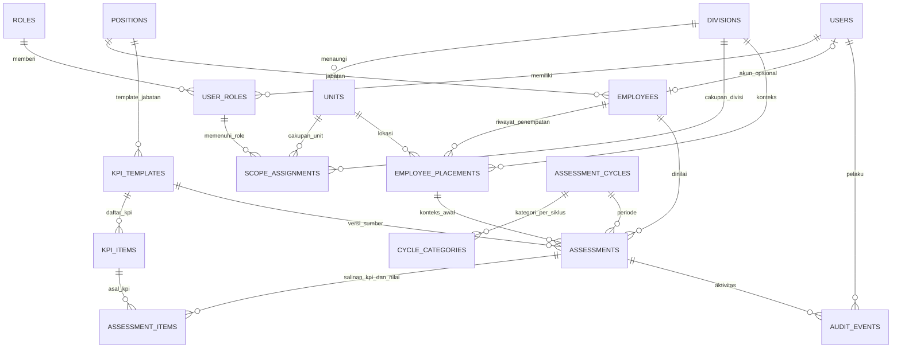

# SCHEMA — KPI Kinerja Bulanan Awal Bros

**Acuan:** PRD KPI Kinerja Revisi v1.1 (8 November 2026)  
**Target:** MySQL 8.4 LTS (InnoDB, utf8mb4), implementasi menggunakan Laravel 13 / Eloquent / migrations.  
**Status:** rancangan teknis untuk ditinjau SDM dan IT; **bukan** keputusan atas butir OPEN pada PRD.

## 1. Prinsip pemodelan

1. Satu karyawan memiliki **maksimal satu penilaian untuk satu siklus/bulan** (`UNIQUE(employee_id, cycle_id)`), tanpa tergantung unitnya saat ini.
2. `users` (akun login) dan `employees` (orang yang dinilai) **berbeda**. Karyawan tidak wajib mempunyai akun; akun pengelola boleh terhubung ke satu karyawan.
3. Jabatan menentukan template KPI; **unit menentukan keanggotaan**. Jabatan bukan substitusi cakupan unit.
4. Cakupan akses berasal dari **penugasan aktif di server**, bukan dropdown, URL, session role yang tidak divalidasi, atau field `division_id` yang dikirim klien.
5. Struktur dan penugasan tidak dihapus secara fisik jika sudah mempunyai histori. Pemindahan mencatat penempatan lama dan baru; Final tidak dimutasi.
6. Versi Master KPI dipertahankan. Saat penilaian dibuat, isi KPI dan bobot disalin ke `assessment_items`; pada Final, salinan identitas, struktur organisasi, kategori, dan hasil sudah lengkap dan terkunci.
7. `Belum diisi` adalah **status tampilan virtual** (belum ada record `assessments`), bukan record kosong untuk seluruh kombinasi karyawan-periode.
8. Semua mutasi penting dilakukan dalam **transaksi database** dan ditambahkan ke `audit_events` dalam transaksi yang sama.
9. Tanggal/waktu kejadian disimpan dalam **UTC** dan ditampilkan dalam **Asia/Jakarta (WIB)**; bulan penilaian disimpan terpisah sebagai tanggal hari pertama bulan terkait.
10. Nilai/bobot memakai `DECIMAL` (bukan `FLOAT`/`DOUBLE`). Pembulatan dua desimal hanya untuk **tampilan**.

## 2. ERD konseptual



Diagram sengaja menyederhanakan FK lain. Detail field, constraints, dan indeks mengikuti bagian berikut serta `schema.mysql.sql`.

## 3. Kamus entitas dan kolom

Tipe berikut memakai idiom MySQL. Seluruh tabel mempunyai `id BIGINT UNSIGNED AUTO_INCREMENT PRIMARY KEY` kecuali tabel pivot `user_roles`. Kolom waktu `*_at` bertipe `DATETIME(6)` atau `TIMESTAMP(6)` sesuai DDL, dan audit bersifat append-only.

### A. Identitas, organisasi, akses (P0)

#### `users` — akun aplikasi

| Kolom | Tipe | Ketentuan |
|---|---|---|
| id | BIGINT UNSIGNED | PK |
| name | VARCHAR(160) | Wajib |
| email | VARCHAR(190) NULL | Unik jika ada; login email |
| login_nip | VARCHAR(64) NULL | Unik jika ada; alternatif login NIP |
| password | VARCHAR(255) | Hanya hash; tidak pernah masuk audit |
| is_active | BOOLEAN | Default true |
| last_login_at | DATETIME(6) NULL | Informasi akses |
| created_at, updated_at | DATETIME(6) | Timestamp |

`email` atau `login_nip` minimal satu terisi. Sinkronisasi `users.login_nip` terhadap `employees.nip` untuk akun yang ditautkan divalidasi pada layanan identitas (karena tabelnya berbeda). **SSO tetap O-4/OPEN**; tabel ini tidak mengklaim sistem SSO sudah ditentukan.

#### `roles`, `user_roles` — kelayakan role

- `roles`: `key VARCHAR(32) PK`, `label`. Seed tetap: `super_hc`, `kepala_divisi`, `kepala_unit`.
- `user_roles`: PK gabungan (`user_id`, `role_key`), FK ke `users` dan `roles`. Menyatakan akun **layak ditugaskan** sebagai role tersebut; **belum** memberi akses ke suatu unit/divisi.
- Jika user tidak aktif atau kelayakan role dicabut, akses tidak berlaku walau penugasan lama ada. Cabut penugasan aktif dahulu sebelum menghapus kelayakan role.

#### `divisions`, `units` — struktur

- `divisions`: `id`, `code UNIQUE`, `name`, `is_active`, timestamps.
- `units`: `id`, `division_id FK`, `code`, `name`, `is_active`, timestamps; `UNIQUE(division_id, code)`.
- Kepala Divisi/Unit **tidak** disimpan sebagai kolom tambahan di sini: penanggung jawab aktif diturunkan dari `scope_assignments` agar tidak ada dua sumber kebenaran.
- Pindah induk `unit.division_id` untuk unit yang mempunyai anggota/penilaian **diblokir** sampai prosedur dampaknya disahkan; tidak boleh update sembarang.

#### `scope_assignments` — pemberian cakupan pada akun

| Kolom | Tipe | Ketentuan |
|---|---|---|
| id | BIGINT UNSIGNED | PK |
| user_id, role_key | FK gabungan | Harus tercatat di `user_roles` |
| division_id | FK NULL | Wajib hanya bagi Kepala Divisi |
| unit_id | FK NULL | Wajib hanya bagi Kepala Unit |
| assigned_at | DATETIME(6) | Waktu mulai akses secara operasional |
| revoked_at | DATETIME(6) NULL | NULL berarti aktif |
| assigned_by | FK users NULL | Pelaku penugasan |
| revoked_by | FK users NULL | Pelaku pencabutan |
| note | TEXT NULL | Alasan/konteks administratif |

`CHECK`: `super_hc` tidak punya divisi/unit; `kepala_divisi` hanya `division_id`; `kepala_unit` hanya `unit_id`. Dua **generated stored columns** (`active_division_head_id`, `active_unit_head_id`) bersama `UNIQUE` memastikan maksimum satu Kepala Divisi aktif per divisi dan satu Kepala Unit aktif per unit (sesuai **USUL** PRD). Nilai generated column menjadi `NULL` untuk penugasan yang dicabut sehingga histori tak melanggar keunikan.

Model memungkinkan banyak divisi dan unit serta banyak pengguna. Kebijakan **satu orang menangani banyak area**, **delegasi**, **tanggal efektif masa depan**, dan **pemilihan konteks multi-role** tetap **O-5/O-6 OPEN**; aplikasi tidak boleh memunculkan mode role demo atau memberi akses diam-diam.

#### `positions`, `employees`, `employee_placements`

- `positions`: `id`, `code UNIQUE`, `name`, `is_active`.
- `employees`: `id`, `nip UNIQUE`, `full_name`, `position_id FK`, `user_id NULL UNIQUE FK`, `is_active`, timestamps.
- `employee_placements`: `id`, `employee_id FK`, `unit_id FK`, `division_id FK` (snapshot induk pada saat penempatan), `started_at`, `ended_at NULL`, `reason`, `created_by FK`, `ended_by FK`.
- Generated column `active_employee_id` = `employee_id` hanya jika `ended_at IS NULL`, dengan `UNIQUE(active_employee_id)`: **mencegah dua penempatan aktif untuk orang yang sama** di tingkat database.
- Dalam transaksi pemindahan, cek `unit.division_id = division_id`, tutup placement lama, buat placement baru, tulis audit. Jangan menghapus placement lama. Untuk masalah penilaian aktif, **blokir perpindahan** sambil menunggu kebijakan O-6; jangan membuat perilaku implisit.

### B. Master KPI (P0)

#### `kpi_templates`

| Kolom | Tipe | Ketentuan |
|---|---|---|
| id | BIGINT UNSIGNED | PK |
| position_id | FK | Template milik jabatan |
| name | VARCHAR(190) | Nama template |
| template_year | SMALLINT UNSIGNED | Tahun yang dimaksud |
| version | INT UNSIGNED | Versi dalam tahun/jabatan |
| status | VARCHAR(16) | `draft`, `published`, `retired` |
| effective_from, effective_until | DATE NULL | Rancangan dukungan masa berlaku; kebijakan O-11 |
| published_at | DATETIME(6) NULL | Diisi jika terbit |
| created_by | FK users | Pelaku |

`UNIQUE(position_id, template_year, version)`. Hanya template **published** boleh menjadi sumber penilaian. Setelah `published` atau pernah digunakan, konten tidak bisa diedit in-place: buat versi baru. Validasi **jumlah bobot tepat 100.0000%** sebelum publish. Satu template efektif per jabatan/periode harus dibuktikan oleh service resolver; aturan masa berlaku dan overlap adalah **O-11 OPEN**.

#### `kpi_items`

- `id`, `template_id FK`, `sort_order`, `pillar` (nilai tetap: Technical Care; Access; Coordination and Continuity; Interpersonal Care; Efficient), `name`, `numerator`, `denominator`, `measurement_formula`, `target_text`, `weight_percent DECIMAL(8,4)`.
- `UNIQUE(template_id, sort_order)` dan `CHECK(weight_percent > 0 AND weight_percent <= 100)`.
- Target disimpan sebagai **teks**; misalnya `95%`, `Tidak ada`, `0 complaint`, `<20%`.
- Validasi jumlah bobot lintas baris harus dilakukan **server-side** di transaksi publish; `CHECK` SQL per baris tidak bisa menjumlah satu template.

### C. Siklus, kategori dan penilaian (P0)

#### `assessment_cycles`

- `id`, `assessment_month DATE UNIQUE` (`YYYY-MM-01`), `opens_at`, `submission_due_at`, `approval_due_at`, `closes_at`, `status` (`planned`, `open`, `closed`), `created_by` dan timestamps.
- **Bulan penilaian bukan bulan pemrosesan**. Contoh: `2026-10-01` dinilai pada jadwal November 2026. Semua timestamp disimpan UTC, jadwal ditampilkan WIB.
- Urutan jadwal diverifikasi. Tenggat 5/10/15 dan 8/10/15 adalah contoh, **bukan nilai baku sistem**. Perlakuan tindakan setelah tenggat **O-9 OPEN**: sebelum diputuskan, jangan membuat override tersembunyi.

#### `cycle_categories`

- `id`, `cycle_id FK`, `code`, `label`, `lower_bound DECIMAL(12,6)`, `upper_bound DECIMAL(12,6) NULL`, `sort_order`.
- Rentang **[lower_bound, upper_bound)**, batas bawah inklusif, batas atas eksklusif, `upper_bound NULL` untuk rentang tertinggi. Contoh usulan: Kurang `[0,70)`, Cukup `[70,80)`, Baik `[80,90)`, Sangat Baik `[90,+∞)`.
- Pastikan kategori **tidak tumpang tindih dan tidak menyisakan celah** pada rentang skor yang berlaku. Validasi cross-row dan pengesahan kategori O-2 dilakukan di service, bukan mengandalkan satu `CHECK`.
- Sebelum Final, perubahan kategori perlu kontrol dampak dan audit; setelah ada Final, jangan menulis ulang histori: gunakan versi/siklus baru atau aturan yang disahkan.

#### `assessments` — satu header penilaian per karyawan/periode

| Kolom | Tipe | Ketentuan |
|---|---|---|
| id | BIGINT UNSIGNED | PK |
| employee_id, cycle_id | FK | `UNIQUE(employee_id, cycle_id)` |
| placement_id | FK | Penempatan sumber pada saat membuat penilaian |
| division_id, unit_id, position_id | FK | Konteks penilaian yang melekat, tidak ikut berpindah |
| kpi_template_id | FK | Template dan versi sumber |
| employee_name_snapshot, nip_snapshot | VARCHAR | Nama/NIP saat penilaian |
| division_name_snapshot, unit_name_snapshot, position_name_snapshot | VARCHAR | Nama organisasi pada penilaian |
| template_name_snapshot, template_version_snapshot | VARCHAR, INT | Identitas template |
| status | VARCHAR(16) | `draft`, `submitted`, `returned`, `approved`, `final` |
| positive_finding, negative_finding | TEXT NULL | Temuan, tidak memengaruhi total |
| total_score_raw | DECIMAL(12,6) NULL | Total hasil server, tidak dibulatkan ke 2 desimal |
| category_code_snapshot, category_label_snapshot | VARCHAR NULL | Diisi saat Final |
| category_lower_snapshot, category_upper_snapshot | DECIMAL NULL | Rentang kategori yang digunakan saat Final |
| submitted_at, approved_at, finalized_at | DATETIME(6) NULL | Jejak tahapan |
| approved_by, finalized_by | FK users NULL | Pelaku tahapan |
| lock_version | INT UNSIGNED | Optimistic concurrency, dimulai 0 |
| created_at, updated_at | DATETIME(6) | Timestamp |

`assessment.status` menyimpan status proses, **bukan kategori hasil**. `submitted` menampilkan label **Diajukan**; `approved` = **Disetujui**; `returned` = **Dikembalikan**; `final` = **Final**. Metadata keputusan (alasan pengembalian, pengajuan, tarik, approve, perubahan skor) direkam permanen dalam `audit_events`. Pengguna tidak dapat mengedit record `final` melalui UI, API, maupun service.

`division_id`, `unit_id`, dan nama snapshot sengaja tidak ikut berubah ketika organisasi master berubah. Catatan akses histori lintas mutasi tetap **O-7 OPEN**, sehingga kebijakan aman adalah **jangan memperluas** akses ke histori di luar konteks yang benar-benar sah.

#### `assessment_items` — KPI yang telah disalin dan diberi skor

- `id`, `assessment_id FK`, `source_kpi_item_id FK`, `sort_order`, `pillar_snapshot`, `kpi_name_snapshot`, `numerator_snapshot`, `denominator_snapshot`, `formula_snapshot`, `target_snapshot`, `weight_percent_snapshot DECIMAL(8,4)`, `score TINYINT UNSIGNED NULL`, `weighted_result_raw DECIMAL(12,6) NULL`.
- `UNIQUE(assessment_id, source_kpi_item_id)` dan `UNIQUE(assessment_id, sort_order)`; skor NULL pada Draft belum lengkap.
- `CHECK(score IS NULL OR score BETWEEN 10 AND 100)`, sehingga tidak ada nilai pecahan (tipe integer), 0, atau 101. Saat submit, seluruh KPI harus memiliki skor.
- Dengan bobot dalam **persen**: `weighted_result_raw = score * weight_percent_snapshot / 100`. Total ialah **jumlah** seluruh `weighted_result_raw` yang valid.
- Frontend bisa menghitung preview saat user mengetik, tetapi setiap mutasi disimpan dengan hitung ulang server. Jangan menggunakan angka total yang dikirim browser sebagai sumber kebenaran.

### D. Jejak perubahan (P0)

#### `audit_events`

| Kolom | Tipe | Ketentuan |
|---|---|---|
| id | BIGINT UNSIGNED | PK |
| subject_type, subject_id | VARCHAR(64), BIGINT | Jenis & ID entitas (penilaian/struktur/akun/template/dll.) |
| assessment_id | FK NULL | Memudahkan timeline penilaian |
| actor_user_id | FK NULL | Pengguna pelaku; nullable untuk job sistem |
| actor_role_key | VARCHAR(32) NULL | Konteks role saat tindakan |
| scope_division_id, scope_unit_id | BIGINT NULL | Cakupan saat tindakan (data audit) |
| action | VARCHAR(80) | `assessment.submitted`, `employee.transferred`, dst. |
| status_before, status_after | VARCHAR(16) NULL | Untuk perpindahan status |
| before_data, after_data | JSON NULL | Perubahan yang diizinkan dicatat |
| reason | TEXT NULL | Alasan, bila relevan |
| request_key | VARCHAR(64) NULL UNIQUE | Idempotency token untuk mutasi kritis |
| recorded_at | TIMESTAMP(6) | Waktu pencatatan |

- **Append-only:** tidak ada endpoint edit/hapus, retention backup minimal 5 tahun, akses baca dibatasi. Untuk lingkungan produksi, batasi izin DB aplikasi agar tidak dapat `UPDATE`/`DELETE` di tabel audit (dengan migrator berizin terpisah).
- Hindari logging password/hash, token, data sesi, dan informasi pasien. Jejak `before_data`/`after_data` disanitasi (allowlist field), bukan dump model penuh.
- `request_key` adalah UUID unik per operasi mutasi kritis (termasuk per-item saat operasi massal) dan dipakai untuk mengenali retry; mekanisme pengembalian response hasil retry ditentukan di action Laravel.
- Index `assessment_id, recorded_at` untuk riwayat penilaian; `subject_type, subject_id, recorded_at` untuk audit umum.

## 4. Relasi dan batasan kunci

| Aturan | Pengamanan database | Pengamanan service Laravel |
|---|---|---|
| Satu nilai per karyawan/bulan | UNIQUE employee+cycle | `firstOrCreate` bukan jaminan tunggal; tangani duplicate key dan lock |
| Satu penempatan aktif | Generated column + UNIQUE | Transaksi pindah & pemeriksaan dampak |
| Satu kepala aktif per area (USUL) | Generated columns + UNIQUE | Validasi akun aktif dan role sesuai |
| Role punya cakupan tepat | CHECK + composite FK | `ScopeResolver` + Policies |
| Semua KPI total 100% | CHECK bobot per baris | `PublishTemplateAction` validasi SUM 100.0000 |
| Skor integer 10–100 | TINYINT + CHECK nullable | Validasi pada submit, Draft boleh kosong |
| Final terkunci | Tidak cukup oleh CHECK | Policy + action + izin DB; tidak ada endpoint unlock |
| Final tidak berubah saat mutasi | Snapshot denormalisasi | Pemindahan tidak mengubah assessment Final |
| Seluruh mutasi tercatat | FK/indeks audit | Audit ditulis atomik dalam transaction |
| Konflik update | Kolom `lock_version` | `WHERE id=? AND lock_version=?`, gagal → HTTP 409 |
| Kategori tak overlap | CHECK rentang masing-masing | Validasi seluruh rentang dalam transaksi |
| Akses daftar/detail/agregat | Tidak bisa dijamin hanya dengan FK | Semua query memakai scope dan policy server |

**Foreign key:** `RESTRICT/NO ACTION` pada entitas bernilai historis, bukan cascade delete. Penonaktifan menggunakan `is_active` / `revoked_at` / `ended_at`.

## 5. Rumus, contoh uji dan presisi

**Pilihan teknis yang diusulkan (O-11 belum disahkan):** `weight_percent DECIMAL(8,4)` dalam satuan **persen**, `weighted_result_raw DECIMAL(12,6)`, `total_score_raw DECIMAL(12,6)`. Angka disimpan numerik biasa; tampilan memakai koma dan 2 desimal.

```text
KPI 1:  90 × 15.0000 / 100 = 13.500000
KPI 2:  80 × 10.0000 / 100 =  8.000000
KPI 3: 100 × 10.0000 / 100 = 10.000000
KPI 4:  85 × 25.0000 / 100 = 21.250000
KPI 5:  75 × 20.0000 / 100 = 15.000000
KPI 6:  75 × 20.0000 / 100 = 15.000000
TOTAL                         = 82.750000 → UI: 82,75 (Baik, jika batas usulan berlaku)
```

Implementasi PHP disarankan menggunakan operasi `DECIMAL`/string-preserving atau `brick/math`/BCMath untuk penghitungan yang konsisten. Dilarang menjumlahkan `float` JavaScript lalu menyimpannya sebagai total otoritatif.

## 6. Alur data dan snapshot

1. SDM publish versi template yang jumlah bobotnya tepat 100% dan menetapkan siklus + kategori.
2. Kepala Unit membuka anggota dalam scope. Jika penilaian belum ada, Laravel mengambil penempatan, jabatan, template yang berlaku; membuat `assessments` + `assessment_items` **dalam satu transaksi**.
3. Draft bisa parsial. Perubahan skor/temuan dan nilai lama-baru dicatat di `audit_events`.
4. Submit memeriksa cakupan, status `draft/returned`, periode, semua nilai integer 10–100, kesesuaian bobot; menghitung ulang setiap hasil dan total pada server; mengubah status ke `submitted` serta audit.
5. Kepala Divisi `approve` atau `return` berdasarkan konteks assessment yang sah. Return oleh KD **wajib alasan**. Super HC dapat return dari `approved` sesuai PRD.
6. Finalisasi hanya untuk `approved`: cek ulang ketentuan, resolve kategori siklus, simpan kategori dan batasnya sebagai snapshot, `finalized_at`, pelaku, status `final`, audit, sekaligus dalam transaction.
7. Setelah Final: tidak ada edit item, temuan, konteks ataupun status. **Unlock masih O-8** dan sengaja tidak dirancang sebagai route aktif.

## 7. Indeks dan strategi query

- `assessments(employee_id, cycle_id)` unik; `assessments(cycle_id, status, division_id, unit_id)` dan `(cycle_id, division_id, status)` untuk antrean/progres.
- `assessment_items(assessment_id, sort_order)` dan `(assessment_id, source_kpi_item_id)` unik untuk penyajian/akurasi.
- `employee_placements(unit_id, ended_at)`, `employees(position_id, is_active)`, `units(division_id, is_active)` untuk daftar anggota.
- `scope_assignments(user_id, revoked_at, role_key)` untuk evaluasi akses dan `UNIQUE(active_*_head_id)` untuk kepala.
- `kpi_templates(position_id, template_year, status)` untuk pemilihan template; validasi masa berlaku dilakukan dalam service.
- `audit_events(assessment_id, recorded_at)` dan `(subject_type, subject_id, recorded_at)`.
- Gunakan pagination + eager loading; agregat memakai query dengan scope dahulu. Jangan cache rekap lintas role dengan key tanpa scope.

## 8. Status pekerjaan dan keputusan terbuka

**Sudah berasal dari PRD:** hierarki Super HC → divisi → unit → anggota, role/otorisasi, audit, batas nilai 10–100, bobot 100%, satu penilaian per bulan, temuan tidak masuk total, status dan finalisasi, snapshot Final, rancangan P0/P1/P2.

**Pilihan teknis usulan:** pemisahan `user_roles` vs `scope_assignments`, audit event tunggal, UUID request idempotency, nama tabel/kolom, key BIGINT, presisi DECIMAL, penggunaan UTC di penyimpanan, satu kepala aktif via generated unique, `Belum diisi` virtual.

**Belum boleh diasumsikan selesai:** O-1 bobot turunan KPI, O-2 batas kategori sah, O-3 akses karyawan/penilai kepala, O-4 SSO, O-5 multi-role/delegasi, O-6 tanggal efektif dan penilaian aktif saat pindah, O-7 akses histori lintas mutasi, O-8 unlock, O-9 izin setelah tenggat, O-10 pengingat/alasan SDM return, O-11 versi/presisi, O-12 spesifikasi visual/performa pilot.

## 9. Urutan migrations Laravel yang disarankan

1. `create_users_table`, `create_roles_table`, `create_user_roles_table`.
2. `create_divisions_table`, `create_units_table`, `create_positions_table`, `create_employees_table`.
3. `create_scope_assignments_table`, `create_employee_placements_table`.
4. `create_kpi_templates_table`, `create_kpi_items_table`.
5. `create_assessment_cycles_table`, `create_cycle_categories_table`.
6. `create_assessments_table`, `create_assessment_items_table`.
7. `create_audit_events_table`.
8. Seeder role dan data **fiktif** untuk uji isolasi dua divisi; hindari data pasien maupun data karyawan nyata di development.

**Catatan:** `schema.mysql.sql` adalah DDL referensi teknis, bukan pengganti Laravel migrations. Terapkan `CHECK`, generated columns, dan aturan privilege database dengan migrations yang diuji di MySQL 8.4 sungguhan; SQLite tidak cukup untuk menguji behavior ini.
