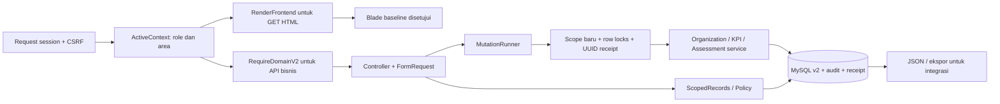

# Arsitektur MVC KPI v3

Laravel 13/PHP 8.3+/MySQL dalam satu root. Blade/Tailwind/JavaScript native memakai API nyata. Better Auth pada `services/auth` menangani login dan sesi melalui MySQL.

Browser -> Laravel CSRF -> Better Auth BFF -> layanan Node loopback -> auth_accounts/auth_sessions. Guard Laravel memverifikasi sesi, akun dan penugasan terkini sebelum ActiveContext/Policy. Sesi PHP hanya menyimpan CSRF/flash; tidak menjadi sumber autentikasi. Request bisnis tetap mengikuti MVC dan transaksi di bawah ini. Workspace JSON telah dibatasi server; pagination/filter UI bekerja pada data resmi dalam cakupan tersebut, tanpa localStorage bisnis. Nama komponen RenderFrontend tetap dipakai untuk shell HTML, bukan mode demo pada aplikasi berakun.



RenderFrontend berjalan sebelum guard schema pada halaman HTML, sehingga layout/login lama tetap tersedia selama adopsi database. API bisnis menolak schema yang belum sesuai dengan 503, tanpa menulis data lama.

## Tanggung jawab

- Controller/Request: kontrak HTTP, validasi input dan response.
- ActiveContext/ScopeResolver: akun aktif, idle 30 menit, role saat ini dan satu scope aktif; penugasan historis tidak memberi akses sendiri.
- ScopedRecords/Policy: batas area sebelum lookup/list/count/export. KU hanya member dalam unit; KD dua jenis dalam divisi; HC global tanpa hak skor/keputusan.
- MutationRunner: reload dan lock aktor, canonical hash payload, replay UUID, otorisasi operasi baru, transaksi dan retry deadlock terbatas.
- OrganizationService: akun -> jabatan -> area dengan kepala -> staf/placement; perubahan struktur dan hapus terjaga dependensi.
- KpiMasterService: scoped version, bobot, segel, masa berlaku/counter, kategori dan siklus.
- AssessmentService: form baca saja, kirim lengkap, return/resubmit, pembatalan, Final dan snapshot.
- Models + MySQL: casts DECIMAL, FK/UNIQUE/CHECK, generated result, guard Final dan audit append-only.
- Profile/Notification controllers: profil sendiri, foto privat/preferensi, tugas terhitung dan status baca. Tidak mengirim pesan eksternal.

## Alur transaksi

```text
Belum diisi = tidak ada assessment.
Staf: kirim lengkap -> submitted -> final oleh KD
                              -> returned dengan alasan -> kirim lengkap -> submitted
      submitted -> pembatalan KU -> header/item dihapus, audit/receipt tetap ada
Kepala Unit: kirim lengkap oleh KD -> Final dalam satu transaksi
```

Tidak ada draft penilaian atau tahap keputusan HC. Template juga diterapkan melalui satu perintah atomik; sealed_at null hanya sementara di transaksi, bukan draft yang dapat disimpan/diambil lewat API.

Snapshot identitas, organisasi, definisi dan kategori tidak bergantung pada nama master terkini. Transfer memilih placement bulanan; laporan histori tetap pada scope snapshot. Perbandingan bulan sebelumnya mencocokkan definisi, bukan hanya posisi indeks indikator.

## Adopsi

Migration 000001-000004 tetap historis. Migration 000005 memasang snapshot SQL v2 hanya setelah semua tabel data lama terbukti kosong. Jika ada data, migration berhenti sebelum DDL. Tidak ada migrate:fresh/konversi otomatis pada database Laragon pengguna.

Baca [panduan migrasi](../database/MIGRATION-V2.md), [skema](../database/SCHEMA.md), dan [kontrak transaksi](../database/TRANSACTIONS-V2.md). Sandbox review dan fixture bisnis tidak menjadi bagian runtime.
