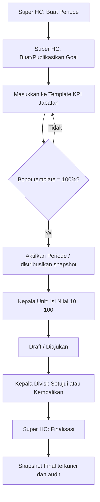

# Spesifikasi Redesign Fitur KPI & Periode — ABPROVE

**Project:** `KPI-Kinerja-UIUX`  
**Versi:** Draft 1.0 — 12 November 2026  
**Jenis:** Feature Specification / UI-UX Handoff  
**Status:** Rancangan perubahan, belum diimplementasikan  
**Referensi:** [Mekari Talenta — Bagaimana Cara Membuat Goals (Tampilan Baru)](https://help-center.talenta.co/hc/id/articles/38679383253145-Bagaimana-Cara-Membuat-Goals-Tampilan-Baru) dan `PRD-KPI-Kinerja-Revisi-v1.1.md`.

> **Instruksi implementasi:** Gunakan dokumen ini untuk merevisi halaman KPI dan Pengaturan Periode pada prototype `KPI-Kinerja-UIUX`. Fokus pada alur, komponen, validasi, dan hubungan antarmodul. Jangan menyalin visual atau branding Mekari secara persis. Pertahankan halaman/fitur di luar ruang lingkup serta aturan penilaian dan hak akses yang sudah ditentukan PRD, kecuali ada perubahan eksplisit di sini. Kebutuhan bertanda **[USULAN]** perlu persetujuan pemilik produk sebelum menjadi aturan produksi.

---

## 1. Tujuan perubahan

Ubah pembuatan KPI dari sekadar pengisian daftar indikator menjadi alur berbasis **Goal** yang terstruktur, mirip pembuatan Goals pada Mekari:

1. Pilih tipe Goal/KPI.
2. Isi identitas dan pemilik Goal.
3. Pilih siklus/periode yang aktif.
4. Tentukan cara pengukuran, baseline, dan target.
5. Tambahkan Key Result bila diperlukan.
6. Atur bobot, pengulangan, alignment, dan opsi progres.
7. Tinjau ringkasan, validasi, lalu simpan/publikasikan.

Pengaturan Periode harus berfungsi sebagai *sumber siklus* yang dipilih ketika membuat atau menggunakan KPI. KPI yang dipublikasikan dapat dialokasikan ke jabatan/unit sesuai cakupan, lalu dipakai dalam lembar penilaian bulanan. Tujuannya memperjelas hubungan antara **apa yang diukur**, **kapan diukur**, **siapa yang bertanggung jawab**, dan **bagaimana hasilnya ditinjau**.

### Keputusan arsitektur pengalaman

- Gunakan istilah **KPI / Goals** pada layar Master KPI; `Goal` adalah target kinerja, `Key Result` adalah hasil ukur pendukung.
- **Periode penilaian** (mis. Oktober 2026) berbeda dari **jadwal proses penilaian** (mis. pengisian 1–5 November 2026).
- **Progress Achievement** (pencapaian aktual terhadap target) **bukan** otomatis **Nilai Penilaian** (skor 10–100). Hubungan keduanya masih **[USULAN / keputusan produk]**.
- Tetap gunakan penilaian bulanan per karyawan dan alur tiga role yang ada; fitur Goal berjenjang penuh adalah peningkatan **P1**, bukan syarat rilis inti.
- Satu karyawan tetap hanya mempunyai satu lembar penilaian per bulan/tahun. Beberapa KPI/Goals berada di dalam lembar tersebut.

---

## 2. Peran dan akses

| Peran | KPI / Goals | Periode | Penilaian |
|---|---|---|---|
| **Super HC** | Buat, edit, duplikasi, aktif/nonaktif, publikasikan Goal, Key Result, template dan bobot | Buat siklus, atur tanggal, buka/tutup, kunci, arsipkan, duplikasi periode | Pantau semua, kembalikan sesuai alur, finalisasi nilai Disetujui |
| **Kepala Divisi** | Lihat Goal divisi/unit dalam naungannya; tidak ubah Master | Lihat siklus dan tenggat relevan | Tinjau, setujui, atau kembalikan penilaian unit dalam divisinya |
| **Kepala Unit** | Lihat Goal/KPI yang ditugaskan ke unit/jabatan; tidak ubah bobot Master | Lihat periode dan tenggat yang sah | Isi nilai anggota unit, simpan Draft, ajukan, revisi bila dikembalikan |
| **Karyawan** | Tidak diberi akun/akses baru secara otomatis | — | Tetap menjadi subjek penilaian; akses mandiri di luar cakupan saat ini |

**Pembatasan keamanan:** Seluruh daftar, pencarian, detail, operasi, dan ringkasan wajib memeriksa role serta cakupan organisasi di server, bukan hanya menyembunyikan tombol pada UI.

---

## 3. Struktur navigasi yang diperbarui

```text
SUPER HC
├── Beranda
├── Rekap & Finalisasi
├── Master KPI / Goals
│   ├── Daftar Goals
│   ├── Buat Goal Baru
│   ├── Detail / Edit Goal
│   ├── Template KPI Jabatan
│   └── Riwayat Versi [USULAN]
├── Pengaturan Periode
│   ├── Daftar Siklus
│   ├── Buat Siklus
│   ├── Detail Siklus
│   └── Pengaturan Kategori Nilai
├── Pengguna & Struktur
└── Analitik

KEPALA UNIT
├── Beranda
├── Isi Nilai
├── Pengajuan
├── Riwayat
├── KPI Unit (read-only)
└── Anggota Unit

KEPALA DIVISI
├── Beranda
├── Persetujuan
├── Dashboard Divisi
└── Tim Divisi
```

- Pertahankan **sidebar dan navbar desktop yang tetap**, bukan menu burger-only.
- Semua halaman berada dalam *dashboard content container* yang konsisten, bukan halaman terpisah dengan gaya berbeda.
- Navbar menampilkan konteks periode dan statusnya; perubahan filter periode menyesuaikan tampilan di bawahnya tanpa mengubah data tersimpan.
- Gunakan design system proyek: **60% netral, 30% hijau pucat, 10% teal**, tipografi, grid, tombol dan state konsisten.

---

## 4. Fitur A — Master KPI / Goals Management

### A1. Halaman daftar Goals

**Header:** `Master KPI / Goals` + deskripsi singkat + tombol primer `+ Buat Goal`.

**Ringkasan:** total Goal Aktif, Draft, Menunggu Publikasi [jika dipakai], Goal tidak aktif, dan jumlah template KPI yang valid.

**Filter:** pencarian nama, periode/siklus, jenis Goal, pilar/kategori, divisi, unit, jabatan, status, dan pemilik (hanya data yang boleh dilihat role).

**Tabel:** Kode, Nama Goal, Tipe, Pilar, Pemilik/Cakupan, Periode, Pengukuran, Bobot, Progress (bila ada data), Status, Aksi.

**Aksi per baris:** Lihat detail, Edit (bila sah), Duplikasi, Nonaktifkan/Arsipkan. Hapus permanen hanya diizinkan jika belum pernah dipakai dan belum memiliki referensi; jika sudah digunakan wajib nonaktif/arsipkan tanpa menghilangkan histori.

**Status Goal [USULAN]:** `Draft`, `Aktif`, `Selesai`, `Diarsipkan`. Status ini terpisah dari status penilaian karyawan.

**Empty state:** `Belum ada Goal untuk periode ini. Buat Goal pertama agar target kinerja dapat ditetapkan.` CTA `Buat Goal`.

### A2. Alur buat Goal: Step 1 — Pilih tipe

Klik `+ Buat Goal`, buka modal pilihan jenis (kartu dengan ringkasan per jenis):

1. **Individual / KPI Karyawan:** diturunkan ke karyawan berdasarkan template jabatan; digunakan dalam penilaian individual.
2. **Team / KPI Unit:** tujuan untuk satu unit.
3. **Organization / KPI Divisi:** tujuan tingkat divisi.
4. **Company / KPI Rumah Sakit:** tujuan keseluruhan rumah sakit.

**Prioritas:** pada P0, fokuskan fungsi penilaian operasional ke **Individual / KPI Karyawan** dan penempatan berdasarkan jabatan/unit. Jenis lain boleh terlihat dengan penjelasan `Segera hadir` jika belum berfungsi penuh; **jangan buat tombol palsu seolah sudah menyimpan**. Implementasi alignment lintas tingkat secara penuh adalah P1.

CTA modal: `Batal` dan `Lanjutkan` (aktif sesudah memilih satu tipe).

### A3. Step 2 — Goal Details

| Field | Komponen | Wajib | Perilaku |
|---|---|---|---|
| Tipe Goal | Badge + tautan `Ubah tipe` | Ya | Selama belum dipublikasikan; ubah memicu konfirmasi bila field bergantung tipe |
| Nama Goal | Text input | Ya | 5–150 karakter, unik secara konteks template/periode sesuai kebijakan |
| Kode Goal | Text input/otomatis | Ya | Kode stabil; larang duplikasi aktif yang membingungkan |
| Deskripsi | Textarea | Tidak | Jelaskan tujuan dan cara interpretasi |
| Pilar/Kategori | Select | Ya | `Technical Care`, `Access`, `Coordination and Continuity`, `Interpersonal Care`, `Efficient` |
| Pemilik Goal | Select bertingkat | Ya | Sesuai tipe: jabatan, unit, divisi, atau RS; cakupan terlihat jelas |
| Penanggung jawab | Select pengguna | [USULAN] | Hanya user aktif dalam cakupan; tidak memberi akses baru secara implisit |
| Template KPI jabatan | Select | Untuk Individual | Menentukan lembar penilaian yang memakai Goal; tampilkan versi template |
| Goal Cycle | Select | Ya | Diambil dari Pengaturan Periode, bukan teks bebas |
| Goal Period | Date range terisi otomatis | Ya | Menampilkan awal/akhir periode; tanggal akhir setelah tanggal mulai |
| Target teks | Text / bantuan | Tidak | Dokumentasi target naratif untuk keterbacaan seperti `95%` atau `<20%` |

Bila Goal dipakai di penilaian jabatan, bidang **Numerator**, **Denominator**, dan **Formula Pengukuran** dari PRD v1.1 tetap tersedia di bagian `Detail Pengukuran`/advanced. Jangan hilangkan data ini dari Master KPI.

### A4. Step 3 — Measurement & Target

| Field | Pilihan/aturan |
|---|---|
| **Measurement type** | `Increase KPI` (semakin tinggi semakin baik) atau `Decrease KPI` (semakin rendah semakin baik) |
| **Measurement unit** | `%`, Angka, Rupiah; tambah unit khusus seperti menit/jam bila benar-benar dibutuhkan dan disetujui [USULAN] |
| **Baseline** | Nilai awal; dapat ditandai `Tanpa baseline` |
| **Target** | Target akhir numerik; wajib untuk KPI terukur |
| **Sumber aktual** | `Input manual` untuk P0; integrasi SIMRS belum termasuk |
| **Progress mechanism** | `Update total achievement` atau `Update per event` (per event dapat P1) |
| **Bobot KPI** | Persentase terhadap template; seluruh KPI aktif dalam satu template versi harus tepat **100%** sebelum publikasi |
| **Repeat measurement** | Reset nilai aktual untuk siklus baru tanpa menghapus histori siklus sebelumnya |

**Validasi:**

- `Increase`: `target > baseline` jika baseline digunakan.
- `Decrease`: `target < baseline` jika baseline digunakan.
- Nilai target dan baseline harus valid menurut satuan; Rupiah dan angka tidak boleh mengandung teks bebas dalam field numerik.
- Jika `baseline = target`, tampilkan error; jangan membagi dengan nol.
- Jika `Tanpa baseline` dipilih, tampilkan cara hitung khusus dan larang mode yang belum didefinisikan.
- KPI yang belum valid boleh `Simpan Draft` tetapi **tidak boleh dipublikasikan**.

**Progress pencapaian [USULAN]:**

- Increase dengan baseline: `progress = ((actual - baseline) / (target - baseline)) × 100`.
- Decrease dengan baseline: `progress = ((baseline - actual) / (baseline - target)) × 100`.
- Jika actual melewati target, simpan angka aktual dan kemajuan mentah; visual progress bar boleh dibatasi sampai 100% namun label harus menjelaskan overachievement (mis. `115%`).
- Untuk `Tanpa baseline`, formula harus diputuskan untuk setiap measurement type sebelum diaktifkan; jangan otomatis gunakan pembagian yang keliru untuk KPI penurunan.

> Catatan: *Pencapaian Goal* ini hanya indikator target operasional. Pada PRD eksisting, **nilai penilaian KPI adalah bilangan bulat 10–100**, dan **hasil KPI = nilai × bobot / 100**. Mengubah pencapaian menjadi nilai penilaian secara otomatis adalah perubahan kebijakan tersendiri dan **belum termasuk default P0**.

### A5. Step 4 — Key Results (opsional)

Di halaman `Buat Goal`, tampilkan seksi `Key Results` dengan CTA `+ Tambah Key Result`; klik membuka **right-side drawer** (bukan pindah halaman).

Field: Nama KR, deskripsi, measurement type, unit, baseline, target, progress mechanism, dan bobot KR [USULAN]. Tampilkan daftar KR dalam kartu ringkas dengan Edit dan Hapus sebelum publikasi.

Perilaku:

- KR opsional; KPI sederhana boleh tidak memiliki KR.
- Jika ada KR, progress Goal **dapat** dihitung dari progres KR berdasarkan bobot/equal-weight, sesuai konfigurasi yang disetujui; hindari double counting Goal + KR.
- Jika bobot KR dipakai, total dalam satu Goal harus 100%; bila tidak diaktifkan, gunakan bobot setara dan tampilkan penjelasan.
- Setelah ada update aktual, perubahan tipe pengukuran, baseline dan daftar KR dibatasi; lakukan versi baru untuk perubahan struktural.
- Pada P0, jangan menambahkan Key Result otomatis ke penilaian skor karyawan sebagai baris terpisah kecuali dipetakan secara eksplisit.

### A6. Step 5 — Set Configuration (drawer)

Dibagi dalam dua bagian:

**Goal Details**
- `Align Goal` [P1]: hubungan tujuan anak ke induk sesuai hierarki yang sah; cegah circular reference.
- `Goal Weight`: bobot penilaian dalam template jabatan.
- `Repeat Goal`: duplikasi konfigurasi target ke siklus berikutnya; aktual tidak ikut tersalin.
- `No Baseline`: mengubah pengukuran setelah pengguna mengonfirmasi konsekuensi rumus.
- `Contributors` [P1]: siapa yang dapat memperbarui aktual Goal; tetap mengikuti otorisasi organisasi, bukan membuat akses baru tanpa persetujuan.

**Target Details**
- Increase/Decrease KPI.
- Tampilan persentase aktual (presisi vs pembulatan tampilan).
- Mekanisme update: akumulasi manual atau *per event* [P1].
- Informasi pengukuran/rumus dan sumber data.

### A7. Step 6 — Review & Submit

Sebelum simpan/publish, tampilkan halaman ringkasan:

- Goal type, nama, pilar, owner, jabatan/unit sasaran.
- Siklus dan tanggal, unit pengukuran, baseline, target.
- KR dan bobot (jika ada).
- Bobot KPI di template, total bobot seluruh template.
- Keterangan dampak: `KPI ini akan berlaku mulai Periode ... untuk Jabatan ...`.

CTA `Kembali`, `Simpan Draft`, `Publikasikan Goal` (terkunci sampai seluruh validasi lulus). Bila mengubah master aktif yang sudah dipakai, tawarkan **Buat versi berikutnya**, jangan tulis ulang data Final.

### A8. Detail Goal

Tampilan: judul, status, owner, periode, persentase pencapaian, baseline → target → actual, grafik progres sederhana, Key Results, riwayat perubahan, dan relasi template/jabatan. Tombol `Edit`, `Duplikasi`, dan `Nonaktifkan` hanya bila diizinkan.

---

## 5. Fitur B — Pengaturan Periode / Goal Cycle Management

### B1. Halaman daftar periode

**Header:** `Pengaturan Periode` + CTA `+ Buat Periode`.

**Ringkasan:** Periode aktif, berikutnya, selesai, dan jumlah lembar penilaian yang menunggu keputusan.

**Tabel:** Nama Periode, Bulan Penilaian, Rentang Goal, Buka Pengisian, Batas Pengajuan, Batas Persetujuan, Batas Finalisasi, Status, Jumlah KPI/Template, Aksi.

Filter: Tahun, bulan, status. Tampilkan timeline/jadwal singkat di detail periode, bukan kalender rumit pada semua halaman.

**Status periode [USULAN]:** `Draft`, `Terjadwal`, `Aktif`, `Proses Persetujuan`, `Ditutup`, `Diarsipkan`. Periode bukan status penilaian individual.

### B2. Alur buat periode

1. Super HC klik `+ Buat Periode`.
2. Isi **Identitas**: nama (mis. `Penilaian Oktober 2026`), tahun, bulan, deskripsi.
3. Isi **Goal Cycle**: frekuensi `Bulanan` sebagai default P0, tanggal awal–akhir bulan penilaian, zona waktu `Asia/Jakarta (WIB)` sesuai PRD.
4. Isi **Jadwal Proses**: tanggal/jam mulai pengisian, batas pengajuan Kepala Unit, batas persetujuan Kepala Divisi, batas finalisasi Super HC, tanggal penutupan. Semua waktu eksplisit.
5. Pilih **Template KPI Berlaku** berdasarkan jabatan/unit, dengan tampilan validitas bobot 100% dan jumlah anggota terdampak.
6. Pilih **Pengulangan**: `Salin konfigurasi KPI dari periode sebelumnya` (tidak menyalin nilai aktual/penilaian) atau `Gunakan template versi yang sudah dipublikasikan`.
7. Tinjau ringkasan: jumlah divisi, unit, anggota, template, validasi jadwal, dan daftar yang belum siap.
8. Simpan `Draft`, `Jadwalkan`, atau `Aktifkan` (tergantung tanggal dan validasi). Tampilkan konfirmasi pengaruh sebelum aktif.

### B3. Validasi dan hubungan tanggal

- Tanggal akhir periode penilaian > tanggal awal (kecuali jam akhir pada hari sama dengan waktu setelah awal yang diizinkan kebijakan; default siklus bulanan mencakup satu bulan penuh).
- Penjadwalan proses harus berurutan: `mulai pengisian ≤ batas pengajuan ≤ batas persetujuan ≤ batas finalisasi ≤ penutupan`.
- Periode penilaian unik untuk satu bulan dan tahun; tidak boleh ada dua periode aktif yang menghasilkan dua lembar penilaian untuk karyawan pada bulan sama.
- Proses penilaian dapat dilakukan bulan berikutnya; **jangan samakan Oktober yang dinilai dengan November waktu input**.
- Tindakan setelah tenggat wajib mengikuti aturan status/pengecualian yang disetujui Super HC [USULAN].
- Perubahan jadwal pada periode Aktif harus menunjukkan daftar pengguna terdampak dan disimpan dalam audit.
- Periode yang sudah mempunyai Final tidak boleh dihapus atau digeser sehingga histori berubah.

### B4. Contoh periode yang jelas

```text
Nama Periode       : Penilaian Oktober 2026
Rentang Goal/KPI   : 01–31 Oktober 2026
Mulai Pengisian    : 01 November 2026, 08:00 WIB
Batas Pengajuan    : 05 November 2026, 23:59 WIB
Batas Persetujuan  : 10 November 2026, 23:59 WIB
Batas Finalisasi   : 15 November 2026, 23:59 WIB
Tanggal Penutupan  : 15 November 2026, 23:59 WIB
```

**Semua tanggal di atas adalah ilustrasi**, bukan aturan baku rumah sakit. Admin harus dapat mengubah jadwal sesuai keputusan kebijakan.

### B5. Duplikasi periode / Repeat cycle

- Tombol `Duplikasi Periode` membuat **Draft periode baru** dengan identitas bulan/tahun baru.
- Salin template versi yang dipilih, relasi jabatan, KPI, target, baseline (sesuai kebijakan) dan bobot; **jangan** menyalin nilai aktual karyawan, review, komentar approval, atau hasil Final.
- Tampilkan pratinjau perubahan template/jabatan/karyawan dan konflik sebelum membuat periode baru.
- Goal berulang mempunyai relasi ke sumber sebelumnya untuk histori, tetapi entri hasil tiap bulan tetap independen.
- Jangan membuat periode baru otomatis tanpa pengaturan eksplisit oleh Super HC.

### B6. Penutupan dan arsip

- Detail periode menampilkan progres status semua penilaian dan daftar yang tertunda.
- `Tutup Periode` meminta konfirmasi dan menunjukkan jumlah belum Final.
- Jika ada penilaian tertunda, blokir penutupan atau wajibkan alur pengecualian yang terdokumentasi [USULAN]; jangan otomatis mengubah Draft/Diajukan menjadi Final.
- Histori Final tetap dapat dibaca sesuai cakupan; tidak boleh diedit atau dihapus.

---

## 6. Integrasi Goals → Penilaian karyawan

### 6.1 Alur data



### 6.2 Status penilaian (tetap sesuai PRD)

`Belum diisi → Draft → Diajukan → Disetujui → Final` dengan cabang `Dikembalikan → Draft → Diajukan`. Kepala Unit dapat menarik `Diajukan` menjadi Draft sebelum disetujui. Tidak ada jalur edit langsung untuk Final.

### 6.3 Perhitungan penilaian (tetap)

- `Nilai KPI` adalah bilangan bulat antara **10 dan 100** untuk pengisian penilaian.
- `Hasil KPI = Nilai KPI × Bobot KPI (%) / 100`.
- `Total Bulanan = Σ Hasil KPI`.
- Total bobot template harus **100%**.
- Kategori default: `≥90 Sangat Baik`, `80–<90 Baik`, `70–<80 Cukup`, `<70 Kurang`; batas dikelola Super HC.
- Temuan positif/negatif opsional dan tidak mengubah rumus.
- Nilai dan total ditampilkan berbeda dari `Actual` serta `Progress (%)` supaya tidak ambigu.

**Contoh:** Goal `Kepatuhan dokumentasi`, baseline 80%, target 95%, actual 92%, progress 80%. Kepala Unit memberi **Nilai Penilaian 85** (sesuai kebijakan penilai). Jika bobot KPI 25%, kontribusi nilai = `85 × 25% = 21,25`. **Jangan** otomatis menyamakan progress 80% dengan nilai penilaian 80 tanpa aturan scoring yang telah disahkan.

### 6.4 Ketentuan snapshot

Saat periode aktif/penilaian dibentuk, simpan referensi **versi template, Goal, target, bobot, pilar, unit, jabatan dan penempatan relevan**. Final menyimpan snapshot yang tidak berubah walau Super HC mengedit Master, anggota dipindah, atau periode baru dibuat.

---

## 7. Desain UI/UX dan interaksi

### 7.1 Prinsip tampilan

- **Tidak meniru warna/identitas Mekari**; pertahankan identitas ABPROVE.
- Sidebar desktop fixed, top navbar stabil, content max-width konsisten, grid 12 kolom desktop.
- Form Create Goal berupa halaman ber-step/section jelas; pemilihan tipe dalam modal, `Key Result` dan `Set Configuration` dalam drawer kanan.
- Komponen yang sama memakai ukuran input/button, radius, border, tipografi, spacing dan hover/focus state seragam.
- Navigasi tidak boleh membuang draft tanpa modal konfirmasi.
- Tampilkan ringkasan validasi dekat tombol simpan dan error inline di field relevan.
- Responsif: drawer menjadi layar penuh di mobile; tabel memakai responsif/scroll yang jelas, bukan teks terlalu kecil.
- Target minimal interaksi: label mudah dipahami staf rumah sakit, bukan istilah OKR berlebihan.

### 7.2 Wireframe konseptual — Create Goal

```text
Super HC / Master KPI / Buat Goal

[1 Pilih Tipe] — [2 Detail & Target] — [3 Key Results] — [4 Konfigurasi] — [5 Tinjau]

Buat KPI / Goal Baru                                      [Simpan Draft]

IDENTITAS GOAL
Tipe: Individual KPI              [Ubah Tipe]
Nama Goal*                         [____________________________]
Pilar/Kategori*                    [Technical Care             v]
Template / Jabatan*                [Perawat Pelaksana          v]
Owner/Cakupan*                     [Unit / Jabatan             v]
Deskripsi                          [____________________________]

PERIODE
Goal Cycle*                       [Penilaian Oktober 2026     v]
Goal Period                        [01/10/2026] — [31/10/2026]

TARGET & PENGUKURAN
Measurement Type*                  (• Increase) (  Decrease)
Measurement Unit*                  [%                        v]
Baseline*                          [80]
Target*                            [95]
Aktual / Progress                  [Diisi pada proses pelaksanaan]
Bobot KPI*                         [25] %

KEY RESULTS (opsional)             [+ Tambah Key Result]
[+] KR: Audit dokumentasi selesai  [Edit] [Hapus]

[Set Configuration]                  Total bobot template: 100%

[Batal] [Kembali]                   [Lanjutkan] [Publikasikan]
```

### 7.3 Wireframe konseptual — Periode

```text
Super HC / Pengaturan Periode

Pengaturan Periode                               [+ Buat Periode]
[2026 v]  [Semua status v]  [Cari periode...]

Oktober 2026   | 01–31 Okt | Isi 1–5 Nov | Setujui 6–10 Nov | Final 15 Nov | Ditutup
November 2026  | 01–30 Nov | Isi ...     | Setujui ...      | Final ...    | Draft

Detail: Penilaian Oktober 2026
[Informasi Periode] [Jadwal Proses] [KPI Berlaku] [Progres & Audit]

Periode Goal : 1–31 Okt 2026
Pengisian    : 1–5 Nov 2026
Persetujuan  : sampai 10 Nov 2026
Finalisasi   : sampai 15 Nov 2026

KPI Valid    : 8 template / bobot 100%
Progres      : 120 Final / 130 penilaian

[Duplikasi ke Bulan Berikutnya] [Lihat Pengaruh] [Tutup Periode]
```

### 7.4 Komponen dan state wajib

`Loading/skeleton`, `empty`, `partial draft`, `validation error`, `permission denied`, `read-only`, `success`, `conflict/version changed`, `network error`, `confirmation destructive`, dan `locked final`.

Microcopy contoh:
- `Bobot template masih 85%. Lengkapi menjadi 100% sebelum dipublikasikan.`
- `Target harus lebih besar dari baseline untuk Increase KPI.`
- `Periode ini sudah memiliki penilaian Final. Perubahan historis tidak diizinkan.`
- `Perubahan belum disimpan. Simpan Draft sebelum keluar?`
- `Tanggal penilaian dan tanggal pengisian berbeda. Pastikan jadwal sudah benar.`

---

## 8. Data konseptual tambahan (bukan migrasi otomatis)

| Entitas | Field penting | Catatan |
|---|---|---|
| `goal_cycles` / `periods` | id, nama, year, month, goal_start_at, goal_end_at, input_open_at, submit_due_at, approval_due_at, final_due_at, close_at, timezone, status | Unique untuk siklus penilaian bulanan |
| `goals` | id, code, name, type, pillar, description, owner_scope, measurement_type, unit, baseline, target, goal_cycle_id, status, parent_goal_id nullable | Goal utama, relasi hierarki P1 |
| `goal_key_results` | id, goal_id, name, measurement_type, unit, baseline, target, weight nullable, progress_mechanism | 0..N per goal |
| `goal_progress_events` | id, goal_id/key_result_id, period_id, actual_value, event_value nullable, actor_id, timestamp, notes | Per-event P1; manual total P0 |
| `kpi_templates` + `template_goal_items` | template_id, version, jabatan_id, goal_id, pilar, bobot, urutan, effective_period | Total bobot satu template harus 100% |
| `assessments` + `assessment_items` | karyawan_id, period_id, status, actual/progress optional, nilai_10_100, bobot_snapshot, result_snapshot, total | Final immutable snapshot |
| `audit_logs` | entity, entity_id, actor_id, role, before, after, reason, time | Termasuk perubahan status dan jadwal |

Gunakan struktur DB eksisting bila sudah ada; tabel di atas hanyalah model konseptual. Jangan melakukan migrasi destruktif dari data penilaian lama.

---

## 9. Prioritas implementasi

### P0 — Harus selesai agar alur inti bisa dipakai

- [ ] Daftar Master KPI/Goals dengan filter dan status.
- [ ] Pilih tipe `Individual KPI`, isi identitas, pilar, template jabatan, periode, measurement type/unit, baseline, target, bobot.
- [ ] Simpan Draft dan publikasikan dengan validasi bobot 100%.
- [ ] Kelola periode bulanan, jadwal input/approval/finalisasi, status, dan template berlaku.
- [ ] Kepala Unit melihat KPI dari periode + template yang tepat; tetap isi nilai 10–100.
- [ ] Kepala Divisi approve/kembalikan; Super HC final; seluruh status dan audit tetap.
- [ ] Final menyimpan snapshot tanpa terpengaruh perubahan Master.
- [ ] Seluruh menu dan operasi mengikuti cakupan role.
- [ ] State error, loading, read-only, confirmation, responsif tersedia.

### P1 — Pengayaan ala Mekari

- [ ] Key Results terstruktur dengan drawer dan perhitungan progress.
- [ ] Goal alignment lintas Unit/Divisi/RS dengan hierarki.
- [ ] Update pencapaian per event dan kontributor terpilih.
- [ ] Repeat Goal/cycle lebih otomatis dengan pratinjau dampak.
- [ ] Perbandingan target dan progres historis.

### P2 — Opsional setelah kebutuhan disahkan

- [ ] Dashboard Goal hierarchy penuh.
- [ ] Integrasi aktual dari SIMRS atau sumber lain.
- [ ] Aturan kalkulasi nilai penilaian otomatis dari progress Goal.
- [ ] Reminder otomatis berdasarkan tenggat dan SLA.

---

## 10. Acceptance criteria / skenario pengujian

1. **Create Goal:** Super HC bisa memilih Individual, membuat Draft dengan field parsial, lalu Publish hanya jika semua field wajib dan template valid.
2. **Increase/Decrease:** Baseline 80 target 95 lolos Increase; baseline 95 target 80 harus ditolak pada Increase, diterima pada Decrease sesuai urutan yang benar.
3. **Bobot:** Template 85% tidak bisa dipublikasikan; 100% bisa. Duplikasi Goal tidak boleh menghasilkan bobot >100% diam-diam.
4. **Periode:** Oktober 2026 dinilai dalam rentang 1–31 Oktober, sementara pengisiannya boleh dijadwalkan pada November.
5. **Unik:** Tidak bisa menciptakan lembar penilaian ganda untuk satu karyawan dalam bulan yang sama.
6. **Draft/Approval:** Kepala Unit bisa Draft → Diajukan; Kepala Divisi hanya review/approve/kembalikan; Super HC hanya finalisasi setelah Disetujui.
7. **Scope:** Kepala Unit IT tidak dapat membaca/menilai anggota Unit Logistik; Kepala Divisi hanya melihat unit di divisinya.
8. **Historical:** Perubahan Master, Goal, periode berikutnya, dan perpindahan anggota tidak mengubah hasil Final sebelumnya.
9. **Progress vs Nilai:** Input actual Goal 92% tidak otomatis mengganti nilai penilaian manual 85 tanpa aturan penghitungan yang disahkan.
10. **Tenggat:** Urutan jadwal invalid ditolak; perubahan saat Aktif butuh konfirmasi dan dicatat audit.
11. **Usability:** Draft tidak hilang saat navigasi; validasi inline dapat dipahami staf; seluruh form dapat dioperasikan keyboard.
12. **Prototype:** Setiap CTA yang ditampilkan memiliki aksi/tampilan state yang relevan; jangan menampilkan tombol interaktif palsu.

---

## 11. Batas perubahan dan keputusan yang masih terbuka

**Jangan ubah tanpa persetujuan:** peran tiga tingkat, enam status penilaian, nilai 10–100, bobot template 100%, kategori nilai, final yang terkunci, histori penempatan, dan struktur multi-divisi/unit.

**Perlu keputusan bisnis sebelum implementasi penuh:**

1. Apakah actual/progress Goal sekadar informasi pendukung atau menjadi sumber perhitungan nilai 10–100 otomatis?
2. Apakah Key Results wajib pada jenis KPI tertentu atau tetap sepenuhnya opsional?
3. Apakah Goal Unit/Divisi/RS hanya untuk monitoring atau juga memengaruhi skor individual?
4. Bagaimana kebijakan perubahan siklus setelah ada penilaian berjalan, overdue, dan penutupan dengan penilaian tertunda?
5. Apakah baseline Goal berulang selalu disalin, direset ke baseline template, atau memakai actual akhir sebelumnya?

**Definisi selesai desain:** seluruh halaman Master KPI dan Periode memiliki flow lengkap, komponen dan state, data contoh konsisten, prototype navigable, serta menunjukkan hubungan antara Siklus → Goal → Template → Penilaian → Approval → Final. Tidak perlu membangun backend untuk menganggap pekerjaan UI/UX selesai; jangan mengklaim interaksi mock sebagai penyimpanan nyata.
